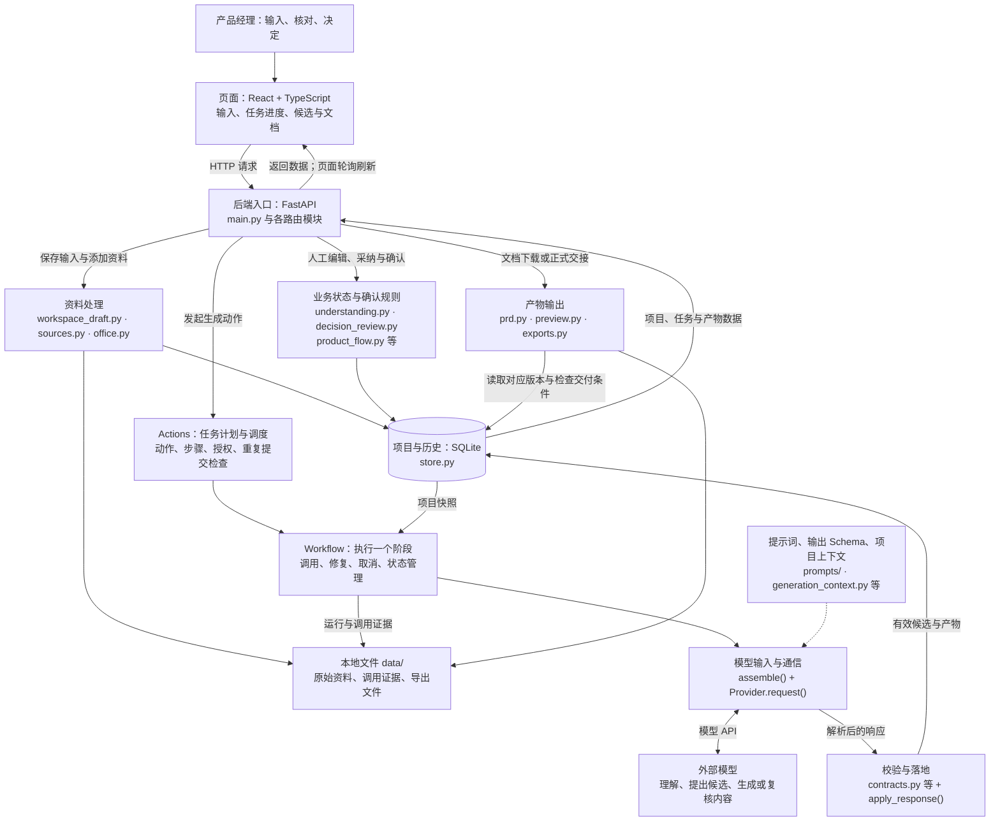

# 需求 Agent 结构图：学习入口

日期：2026-10-09。依据当前工作区源码，包括已有未提交改动；不代表正式发布版本。本次只读核对实现并编写学习说明，没有调用模型、修改业务代码或进行运行验收。

## 总体结构

图中的框按职责组织，箭头表示主要调用或数据流。多数后端框是同一 Python 应用中的模块，不是独立服务；只有模型接收端在应用外部。模型返回后的校验与保存由 Workflow 组织。

`prd.py` 同时参与文档阶段的模型上下文与文档组装，图中将其归到产物职责。`CHECK` 的正式校验前还可能有受约束的引用、分类或 JSON 规范化；正式落地前还要核对任务取消与项目版本。图没有展开每个辅助函数。

## 先认识这八个部件

| 部件 | 解决的问题 | 主要代码入口 |
| --- | --- | --- |
| 页面 | 用户在哪里输入、怎样查看进度和核对结果 | `web/src/main.tsx`、`workspace.tsx`、`pm-prototype/ConnectedWorkspace.tsx`、`api.ts` |
| API 入口 | 哪个地址接住请求，如何验证输入和会话 | `app/main.py:create_app()`；`workspace_draft.py`、`decision_routes.py`、`domain_context_routes.py` |
| 资料处理 | 原话和附件怎样成为有身份、有读取状态的来源与摘录 | `workspace_draft.py`、`sources.py`、`material_images.py`、`office.py` |
| Actions | 用户选的业务动作需要运行哪些阶段，是否允许开始 | `app/actions.py:Actions.plan/start/execute` |
| Workflow | 一个阶段怎么执行、重试或修复，怎样结束并保存状态 | `app/workflow.py:Workflow.start/execute` |
| 模型输入与通信 | 发送哪些上下文，要求什么格式，如何调用模型 | `app/provider.py:assemble()`、`Provider.request()`；`requirements-agent-codex-kit-v1.1/prompts/` |
| 校验与人工确认 | 输出是否符合结构和来源约束，哪些仍是候选，何时允许交付 | `contracts.py`、`understanding.py`、`semantic_quality.py`、`source_fidelity.py`、`result_conditions.py`、`product_flow.py` |
| 保存与输出 | 保存哪个版本、如何保留证据、如何生成阅读和交接文件 | `store.py`、`model_evidence.py`、`prd.py`、`document_reader.py`、`preview.py`、`exports.py` |

## 两种容易混淆的“流程”

1. 用户流程：提供信息 → 完善需求 → 确认交付。内部另有范围、行为、文档等阶段检查。
2. 生成执行流程：业务动作 Action → 一个或多个执行阶段 Stage → 一次或多次模型请求 Call。

因此，一次点击不保证只发一次模型请求。图片处理、格式修复和有目标变化时的决定复核均可能增加请求。请求数、任务结果和人工验收分别记录。

| 用户动作 | 主要执行阶段 | 目的 |
| --- | --- | --- |
| interview | interview；按附件可能先执行 vision | 聊清想法 |
| organize | 没有待识别图片时为 ingest；否则先 vision 再 ingest | 整理当前信息 |
| explore | brainstorm | 比较可选方案 |
| clarify | clarify | 根据回答提出更新候选 |
| prototype | ui | 生成功能草图 |
| document | prd；类型参数区分 MRD / PRD | 生成讨论或评审文档 |
| review | review | 审查当前内容 |
| change | change | 讨论修改方案 |

当前源码用明确的 Action 到 Stage 映射组织生成任务，不由模型自行选择全部后续操作。人工编辑、采纳、确认和导出有直接 API 路径，并非都经过模型生成。

## 把一次操作放回结构图

输入“告警列表增加按电站筛选” → 页面保存共享底稿 → API 将原话保存成来源 → Actions 核对并启动 organize → Workflow 执行 ingest → assemble 拼提示词、Schema、项目快照和有效摘录 → Provider 调用模型 → 程序解析并检查结构、来源、关联和部分业务语义 → 分配永久编号并保存候选、问题、摘要与证据 → 页面读取新项目和任务状态 → 用户核对候选。

模型负责提出内容；程序控制来源、格式、版本、授权、预算与保存；产品经理决定业务语义、采纳与正式确认。自动校验有具体规则覆盖范围，不等于任意业务语义都已被证明正确。

## 支撑层与学习边界

- 运行入口：根目录 `start-local.cmd`，维护脚本 `scripts/start.ps1`、`scripts/stop.ps1`；日常地址 `http://127.0.0.1:8765/`。同一后端提供 API 与 `web/dist/` 静态页面。
- 保护机制：会话与 CSRF、模型配置及凭据、资料发送授权、版本与哈希、预算与请求计数、取消与失败证据。它们跨模块生效，不是流程最后附加的一次检查。
- 回归与说明：`tests/`、`docs/`。历史原型及归档材料不作为当前运行入口。
- 本轮停止点：建立整体职责与主要连接的源码结构图；不展开每个算法，不执行生成，不修改产品。
