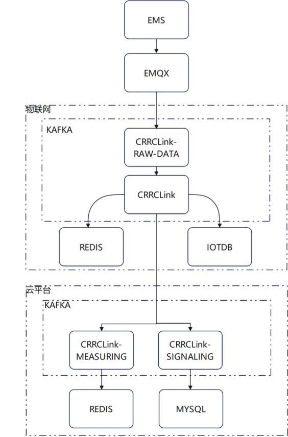

# 用户确认的上行数据架构

2026-10-13，用户通过附图要求修正上一版数据流。以下内容按图记录，身份为用户确认的架构说明，不能改标为源码观察或运行验证。原图的归档位置与 SHA-256 由发布脚本记录在本文末尾。

【A-001｜接入主链】用户确认上行数据由 EMS → EMQX → 物联网分区 Kafka 内的 CRRCLink-RAW-DATA → CRRCLink。节点名称沿用原图；CRRCLink 等节点在此表示图中的数据通道或处理环节，不据此认定每个名称都是独立服务或源码类。

【A-002｜物联网存储分支】CRRCLink 分别连接物联网侧 REDIS 与 IOTDB，即图示的物联网侧 Redis、IoTDB。它们与 CRRCLink 同源分支相连，图中没有 Redis → IoTDB 的箭头；不能把历史数据说明为经 Redis 二次落库。

【A-003｜云平台消费分支】CRRCLink 继续向云平台分区 Kafka 内的 CRRCLink-MEASURING 与 CRRCLink-SIGNALING 分流。MEASURING 连接云平台侧 REDIS，SIGNALING 连接 MYSQL。上行摘要须包含遥测与遥信两条消费分支；图并未逐项定义 SIGNALING 消息及 MySQL 表，不将其扩写为全部告警或全部业务数据。

【A-004｜分区与证据边界】物联网、云平台是图中两个逻辑分区，各有 Kafka 区域，并各自出现 Redis。需要区分两处 Redis 的用途，不能默认相同实例；图也不证明它们物理隔离或 Kafka 属于不同集群。此前源码观察保留为局部实现证据；图中名称与 IecDTO、PointKafkaDTO、ConsumerMeasuringRunnable 等源码符号及实际 topic 的一一对应仍未核实。此次上行图不证明策略下发、回执、BMS/PCS 与 EMS 接线或现场执行结果。

## 原图

## 仍需核对的细节

1. 图中数据通道对应的 topic、具体处理程序和部署开关，以及物联网与云平台 Kafka 的部署关系。
2. 两处 Redis 的实际实例、读写职责与保留周期；IoTDB 写入程序、采样、补发与历史保留周期。
3. CRRCLink-SIGNALING 的消息类型、落库表及与告警/事件业务的对应关系。
4. BMS/PCS 接入 EMS 的具体方式，及 BMS_SOC 与 RACK_SOC_n 的对象和算法。
5. 下行 IoT API 如何到达 EMS，以及接收、回执、执行和效果如何判定。

原图 SHA-256：`1efc3a1554787a2a7e045ccccff7c0aba4b9bbe61db01dfaf87dbde39ffca79b`。原图按原样归档，未修改像素。
