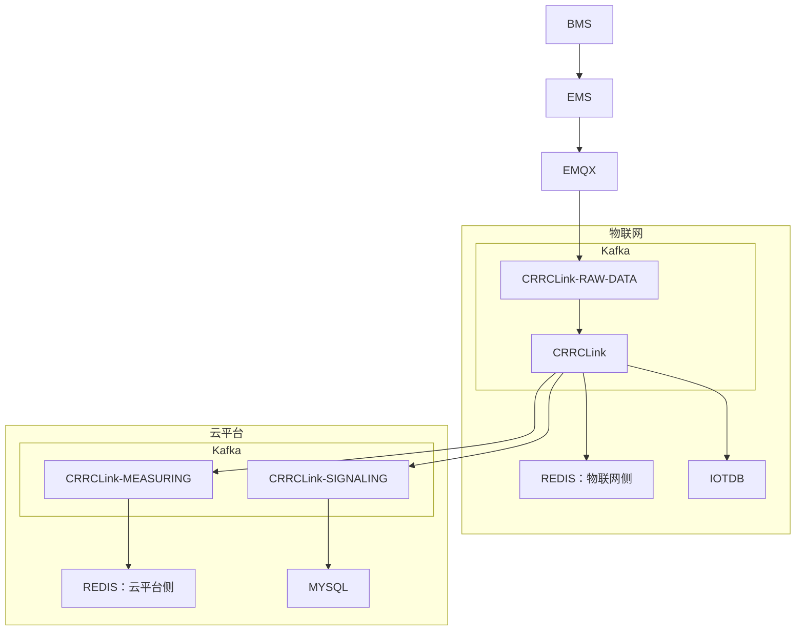
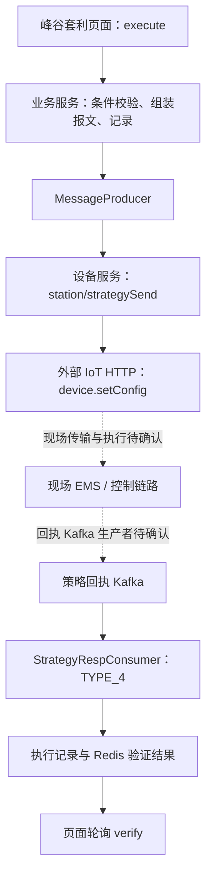

# 当前储能云平台数据流：修正版

2026-10-13。上行主链按用户提供的架构图修正；页面查询及下行部分保留 2026-10-12 的源码观察。用户确认架构、源码观察与尚未核实的实现细节分别说明，没有运行工程或连接生产/现场。图中的虚线框表示逻辑分区，不表示这次仍待确认的主链。

## 先看业务上的数据流

BMS 不与云平台直接交互，BMS 数据先送到 EMS，再由 EMS 经 EMQX 进入物联网侧 Kafka 的 CRRCLink-RAW-DATA，再到 CRRCLink。CRRCLink 分别连接物联网侧 Redis、IoTDB，并向云平台侧 MEASURING 与 SIGNALING 分流；前者连接云平台 Redis，后者连接 MySQL。下图在用户原图基础上补入本次确认的 BMS→EMS 关系。（A-001～A-005）

物联网与云平台是图示的逻辑分区；两处 Redis 的职责分开描述，但不据此断定物理实例隔离或 Kafka 属于不同集群。节点名称是否对应 topic、处理作业或源码类，以及实际配置，仍需研发核对。图中没有 Redis → IoTDB 的箭头。

## 1. 整体架构与源码局部实现对应

用户已补充确认 BMS → EMS；用户图已确认 EMS → EMQX → CRRCLink-RAW-DATA → CRRCLink 主链，以及 CRRCLink 向物联网 Redis、IoTDB 和云平台消费者分流。原文中“现场接入方完全未知”“历史写入方完全未知”的整体描述据此修正，不再重复询问这些已说明的主链。（A-001～A-004）

源码方面，ConsumerMeasuringRunnable 读取 IecDTO，用 deviceNo + pointGroup 匹配采集通道和逻辑设备，再按点位映射形成 deviceId/paramCode 的 PointKafkaDTO 并写配置输出 topic。（C-033）这是已核对的局部实现；它与图中 CRRCLink 各节点的精确对应没有由本次图直接证明，不能擅自把节点名称等同代码类。

业务含义：现场报文需要转成平台认识的逻辑设备与业务信号。整体拓扑已获得用户说明；topic、代码映射、写入程序、采样及保留周期等实现细节继续保留证据边界。

## 2. 最新值、监测曲线、历史曲线分别读取

| 用途 | 已确认的处理与查询路径 | 需要保留的区别 |
| --- | --- | --- |
| 设备最新信号 | `MeasuringRunnable` 消费业务点位并写 Redis hash；业务 `DeviceDataService.getString` 按同名 key 和参数编码取字段。（C-034） | 是最新值路径，不据此保证实时性、全量采样或历史保留。 |
| PCS 监测功率图 | 储能曲线作业写 Redis PCS 曲线；`PcsServiceImpl.queryPCSRealtimePower` 读取曲线及当前功率/状态；前端 PCS 组件调用接口展示。（C-010～C-012、C-035） | 当前功率、曲线点和累计电量是不同内容。生产 Redis 实例与作业开关仍待确认。 |
| BMS 电簇 SOC 摘要 | `CabinServiceImpl.queryBMSRunningStatus` 找到 BMS，读取 Redis 电簇 SOC 曲线，按 `RACK_SOC` 序号解析。（C-036） | 对象与参数编码不能自动等同历史页的 `BMS_SOC`。 |
| SOC 历史曲线 | 当前页面调用 `queryCurve`，提供 BMS 逻辑设备、`tele-measuring`、`BMS_SOC` 和时间范围；业务服务结合 Redis 点位映射、`collectChannel` 生成 IoTDB 查询，返回历史点。（C-037） | Redis 在这里提供映射信息，历史点从 IoTDB 查询。旧 `getAllSocList` 调用已注释；不能把旧入口当作当前页面数据流。 |

**历史写入架构已由用户图确认：CRRCLink 分别连接物联网侧 Redis 和 IoTDB。** 历史查询代码仍按上述路径读取；具体写入程序、采样、补点及保留周期尚未核实，不能改画成 Redis 再落 IoTDB。

## 3. 策略下发与回执

业务到设备服务的调用关系已查明：`distributeMqtt` 调 `MessageProducer.publish`，当前实现经 Feign 调用设备服务；设备服务优先使用电站网关信息，缺失时尝试逻辑设备采集通道，随后调用外部 IoT 的 `/v1/api/device.setConfig` HTTP 接口。（C-026、C-028、C-038）

因此，**方法、日志和报文类中的 MQTT 名称，不证明业务服务当前直接发布 MQTT**。外部 IoT 是否再经 MQTT 到现场，本轮不能确定。

回执消费者处理配置的 Kafka 策略回执；峰谷套利分支调用 `processEmsSendReplyMessage`，按回执更新执行记录、清延时键，并写 Redis 验证结果。页面在提交后轮询 `verify` 读取该结果。（C-027、C-039、C-040）

“接口接受请求”“回执报告成功”“现场功率发生变化”“实现业务收益”分别是不同层面的结果。目前源码支持描述前两者的处理分支，不足以确认现场效果。

## 仍需确认的五个细节

1. 图中各节点与 topic、具体处理程序如何对应？两层 Kafka 的部署关系和作业开关是什么？
2. 物联网侧与云平台侧 Redis 各保存什么数据、保留多久？IoTDB 的具体写入、采样和补点规则是什么？
3. CRRCLink-SIGNALING 具体包含什么消息，写入哪些 MySQL 表，与告警和事件有什么关系？
4. BMS→EMS 的通信协议与数据格式、PCS 的接入关系是什么？历史页 BMS_SOC 与监测图 RACK_SOC_n 对应什么对象和算法？
5. 下行 IoT API 如何把策略送到 EMS？接收、回执、执行和功率达到目标分别怎样判断？

主链和两层分流已按用户图修正。以上只针对尚未说明的细节，第 1 点适合由研发核对部署配置。本图展示上行，不推定下行协议或现场执行结果。

## 核对入口

| 部分 | 关键文件与起始行 |
| --- | --- |
| 原始遥测映射 | [ConsumerMeasuringRunnable.java](D:/99_归档/云平台代码/ytp-后端/cndp/src/main/java/com/cloud/rlsoms/cndp/cloudlink/ConsumerMeasuringRunnable.java:85) |
| Redis 最新值 | [MeasuringRunnable.java](D:/99_归档/云平台代码/ytp-后端/cndp/src/main/java/com/cloud/rlsoms/cndp/cloudlink/consumer/common/MeasuringRunnable.java:71)、[DeviceDataService.java](D:/99_归档/云平台代码/ytp-后端/cnzhny/src/main/java/com/cloud/zhny/business/service/device/DeviceDataService.java:36) |
| PCS 查询 | [PcsServiceImpl.java](D:/99_归档/云平台代码/ytp-后端/cnzhny/src/main/java/com/cloud/zhny/business/service/impl/PcsServiceImpl.java:89) |
| SOC 历史页面与查询 | [SOC 页面](D:/99_归档/云平台代码/zhny-cloud-web-new/src/views/data-analysis/soc-curve/index.vue:191)、[PointRecordServiceImpl.java](D:/99_归档/云平台代码/ytp-后端/cnzhny/src/main/java/com/cloud/zhny/business/service/impl/PointRecordServiceImpl.java:112) |
| 策略实际发送 | [MessageProducer.java](D:/99_归档/云平台代码/ytp-后端/cnzhny/src/main/java/com/cloud/zhny/business/driver/MessageProducer.java:47)、[IotRemote.java](D:/99_归档/云平台代码/ytp-后端/zhny-equ/soms-equ/provider/src/main/java/com/cloud/soms/remote/iot/IotRemote.java:55) |
| 回执与页面验证 | [StrategyRespConsumer.java](D:/99_归档/云平台代码/ytp-后端/cnzhny/src/main/java/com/cloud/zhny/business/kafka/StrategyRespConsumer.java:27)、[StrategyExecuteMainRecordsServiceImpl.java](D:/99_归档/云平台代码/ytp-后端/cnzhny/src/main/java/com/cloud/zhny/business/service/impl/StrategyExecuteMainRecordsServiceImpl.java:163) |

完整源码证据与用户确认稿证据的行号和 SHA-256 保存在活动知识包。上行架构按用户说明使用，源码事实保留快照身份；两者随首次背景直接提供，不要求模型再次检索。
