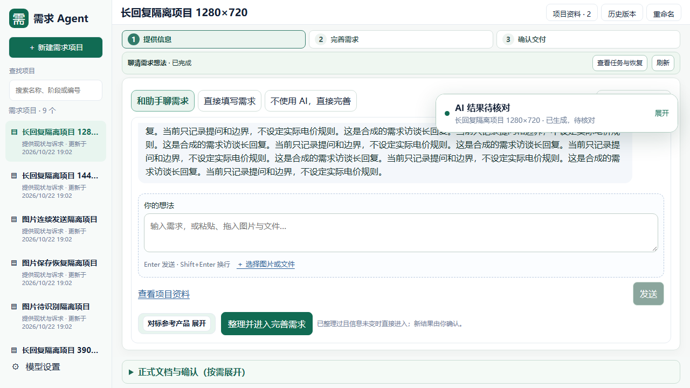
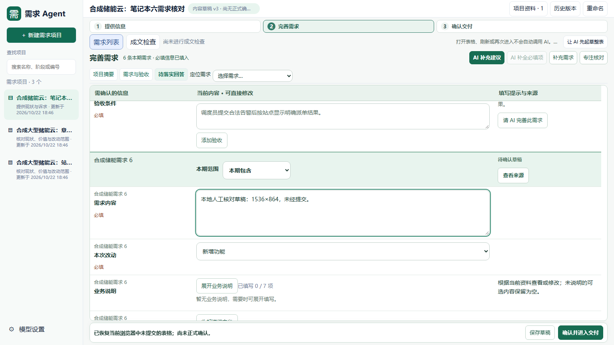

# LLM 输出中断诊断与改进方案

## 本次结论

不能将全部中断归为 JSON 格式错误。当前存在语法、Schema、引用绑定、内容保真四类不同问题；仅增加提示词或整包重试不能解决。

首轮修复将证据分类归一化接到 clarify、change；后续按用户要求完成下述实现。所有归一化保留原始输出与前后哈希，不改业务原文、稳定目标、有效来源和人工确认状态。

## 已实现的后续修复

- 官方 DeepSeek 的已支持模型在 Workflow 各生成阶段及回答覆盖复核中使用 Responses JSON Schema 输出。其它接收端继续兼容原协议；不会静默换模型或将失败请求改发其它服务。
- 模型生成的临时编号有语法问题时，程序生成无碰撞编号并同步显式临时引用；不改稳定编号或正文中的文本。不再为了中文临时编号重跑整包内容。
- 对本轮已发送片段能够唯一确定的来源编号配对进行本地校正。间接条款错填 answer_refs 时，仅在当前有效回答的真实片段已经实际引用、原修订目标和类型有效时移除不适用的绑定，保留 source_refs；有效直接绑定、未知回答、过期回答和无依据引用仍严格校验。
- 完整且未截断的响应如仅缺少可确定的容器闭合，可按 Schema 本地恢复；不补字符串、逗号、缺失业务值。重复键仅内容与类型完全相同时可恢复。超时、截断、冲突重复键、脱敏或不完整证据不能冒充完整结果。
- 失败的 clarify/change 任务可以从最初输出恢复待核对草稿，忽略后续已改写业务的坏修复。只有当前输入及来源仍一致、原始证据完整、全部正常校验通过时才展示恢复入口。恢复操作幂等、零模型请求；原失败记录保留，候选仍需人工核对。

## 原始失败回放

对 bms 项目的两次失败任务、共四份调用输出进行本地校验，不重新请求模型，不写日常项目数据。

- 较早任务的一份输出原先因 new/modified 冲突失败，归一化后单份结果通过校验。
- 最新任务首份输出的临时编号含中文，不符合 Schema；第二份输出修正编号后又被分类冲突拦截。
- 接入分类归一化后，最新第二份输出仍存在越出问题关联范围的 answer_refs。只删除这一无效回答绑定，保留原目标与真实回答来源，在独立离线验证中通过校验及业务保真；这是修复可行性验证，未自动修改日常项目。
- 把最新两份实际输出作为连续修复链核对时，第二份输出还改写了受保护的说明内容，仍会被保真门槛拦截。因此不能宣称这条历史任务已经完整恢复。

原始输出不属于合成测试资料，不提交仓库。忽略目录中的 validation-replay.json、reference-repair-replay.json 记录本次回放结果。

## 实现边界

1. **统一结构化输出入口。** 当前官方 DeepSeek 业务草稿路径已使用 Responses API 的 json_schema；clarify 等旧路径仍使用 Chat Completions 的 json_object。按入口迁移，先验证 Schema 兼容性及合成场景，再做授权的真实请求。结构正确仍须独立做业务校验。
2. **程序处理机械字段。** 临时编号与能由有效证据唯一确定的派生分类由程序生成或归一化；不能改业务原文、稳定 ID、真实来源、阻塞决定或确认状态。规范化记录单独留证。
3. **缩小生成和恢复范围。** 单题、单条需求只返回当前范围的草稿补丁，避免修一个字段却重写整个响应；关联条款与人工编辑需完整保留。局部恢复仍须通过原有引用及保真校验。
4. **保存可恢复草稿并明确错误位置。** 区分“格式待恢复”“引用需核对”“业务内容冲突”。可读取的有效内容作为未采纳草稿保留；错误定位到具体字段，不能靠放宽来源检查或自动确认换取通过。

以上编号、协议、有限格式恢复和原始草稿恢复已实施。任意内容冲突或未知来源不会被当成格式问题吞掉；不能无损恢复的结果仍保留失败证据。通用的逐块独立任务调度未加入，本轮沿用已有单题、单条需求和整表草稿入口，避免另建工作流。

## 真实流程验证

本轮沿用已授权的官方模型配置，只发送合成储能云资料：

- 单题保存回答 → 根据回答更新理解 → 回答覆盖复核 → 待核对修订候选，成功保存。
- 同一个隔离项目中完成资料输入 → AI 起草 → 整表补全 → 模拟用户确认 → 成文检查 → 按冻结资料修正两处内容遗漏并确认落实原文 → 复检通过 → PRD → ZIP 评审稿导出。ZIP 内 Markdown、Word 均可读取，未产生正式业务批准。
- 共计 10 次模型请求账本计数，其中 1 次因测试脚本等待任务句柄错误而取消、未收到响应；原取消记录保留，已修复脚本。最后单独验证了更新后的澄清与回答覆盖复核，两次响应均为 Responses 协议且 accepted。费用未知，没有发送日常项目资料。
- 原 BMS 首轮输出经本地机械修正已通过校验，无需使用那份改写了说明文字的后续修复；真实项目的恢复操作还会重新核对当前输入和来源。

## 笔记本界面

按可用 CSS 视口适配，不进行整页缩放。小屏收紧导航、项目标题和步骤条；需求助手使用单栏，项目语境与资料设置可展开、收起且保留未发送草稿。大屏保留双栏，输入与正文保持可读字号。

## 验证

全量离线回归：2965 passed，另行启用的 5 项本机 Office 测试全部通过。最后新增保护及相关回归另跑 130 passed；前端导航等 14 passed，前端构建通过。真实模型验证与离线测试分别记录，均不等于真实项目业务验收。

浏览器核对：6 种聊天视口各连续 3 轮长回复，附件保存/恢复/发送与小屏辅助区切换通过；8 种核对表视口的定位、专注切换、草稿保留与缺项聚焦通过；本地恢复按钮实际点击通过，模型调用为零。最终构建的 14 组入口、重复点击、取消、跨项目切换和恢复场景全部通过。记录见本机 evidence/llm-reliability-20261022/。

已通过根目录维护脚本更新唯一 8765 工作台。更新前无活动任务并已做 SQLite 一致性备份；更新后运行源码指纹一致，projects/revisions/records/settings/migrations 五表内容哈希均不变，数据库完整性通过。未刷新用户原浏览器页面，未重跑历史任务，未更新试用压缩包。

后续授权修复部署后，调用正式本地恢复接口将 bms统型项目的原 TASK-12005ed34f6147d9 输出恢复为 3 条待确认候选，项目从 revision 39 到 40。未新增模型请求；原条款正文、业务说明、选择状态、原问题回答及状态、来源和正式基线均核对保留。原失败任务及原始调用证据仍保留，恢复操作单独留痕，不等于已采纳候选。

## 官方依据

- [DeepSeek Responses API](https://api-docs.deepseek.com/api/create-response/)：text.format 支持 json_schema。
- [DeepSeek JSON Output](https://api-docs.deepseek.com/guides/json_mode/)：json_object 的使用要求、输出截断与可能空响应说明。
