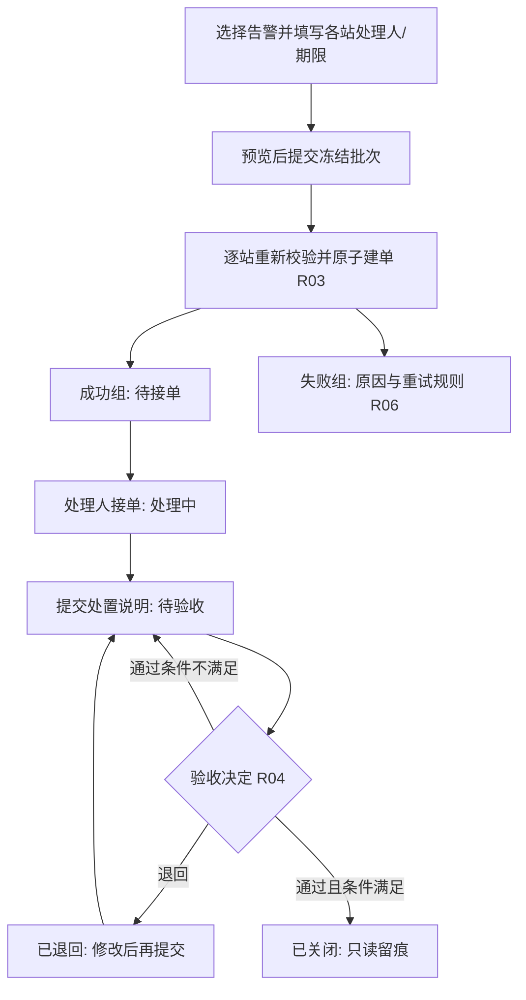

# 多站点告警批量派单与维修验收

**复杂功能 PRD 样稿 · v0.1 · 2026-10-13 · 供产品与研发审核**

本稿是全新合成场景，不取自现有需求或源码。以下角色、数值、字段和规则是本样例统一采用的设计假设，用于检验 PRD 的完整性与篇幅，不代表公司现状或已批准需求。正文直接按这些假设展开，不逐行重复“待确认”。

## 1. 范围、角色与统一约定

### 功能边界

调度员一次选择多个站点的告警，按站点生成工单并指定处理人；处理人接单、处置并提交验收，验收人通过或退回。系统保留每个站点的派单结果，防止重复建单，并区分“告警恢复”和“工单关闭”。

| 包含 | 不包含 |
| --- | --- |
| 告警选择、分组预览、批量建单、失败重试；接单、转派、处置、验收、审计 | 告警生成算法、设备控制、备件/费用、附件、消息推送、审批流配置、工单取消/删除、历史数据迁移 |

依赖输入：身份服务提供用户启用状态、角色和可操作站点集合；告警源提供第 2 节的实例及有序状态事件；资产服务提供站点、设备名称。缺少依赖时按 E01/E06 处理，不推导权限或补造告警。

### 权限矩阵 R01

所有读写同时要求“账号有效 + 对象属于本租户 + 当前有该站点权限”；角色叠加不绕过自验收限制。权限在每次服务端操作时复核。

| 角色 | 查看范围 | 可执行动作 |
| --- | --- | --- |
| 调度员 | 有权站点的告警、工单；本人发起的批次 | 预览、派单、重试；转派未提交验收的工单 |
| 处理人 | 当前指派给本人的工单 | 接单、保存处置草稿、提交验收；转派后原处理人失去该工单访问权，除非另有调度/验收角色 |
| 验收人 | 有权站点中，待验收、已退回、已关闭的工单 | 验收通过、退回；不得验收最近一轮由自己提交验收的工单；转派后变待接单即不在此查看范围 |
| 租户管理员（外部依赖） | 权限管理系统确定 | 恢复调度权限，不凭管理员身份代替本功能的调度、处理或验收角色 |

### 通用属性 G01

ID 为 1～64 位非空字符串，业务标识不可编辑；时间存储为统一时间点，系统生成时间取服务端，用户输入和页面展示按 Asia/Shanghai 至秒。文本先去首尾空白，长度按 Unicode 码点计；必填文本禁止纯空白，可空文本空白归为空串。版本号为从 1 开始递增的整数。

输入草稿只保留在当前页面内存，刷新或关闭页面不保证保留；离开有未提交修改的页面需确认。成功响应以服务端持久化结果为准，按钮结束 loading、列表刷新失败都不能替代业务结果。规则编号 R、异常编号 E、验收编号 A 是文内引用，后文不重复展开原文。

## 2. 数据字典：告警与派单批次

本节“只读”包含服务端生成或依赖输入；“必填”包含在相应操作发生时必须提供。未列为输入的系统字段禁止客户端修改。

### 告警实例 Alarm

| 字段 | 类型 / 空值 / 来源 | 含义与约束 |
| --- | --- | --- |
| alarmId、tenantId、stationId、deviceId | 各为 ID，必有，来源只读 | 一条告警对应一个设备和站点；归属在实例生命周期内不变 |
| stationName、deviceName | 各为文本 1～100，来源只读 | 当前资产名称；派单时另存名称快照，资产改名不改历史快照 |
| summary | 文本 1～200，来源只读 | 告警现象；原样展示，不由模型改写 |
| severity | 紧急 / 重要 / 一般，必有，只读 | 本实例严重度固定；排序与工单优先级按此顺序 |
| occurredAt | 时间，必有，只读 | 首次发生时间；不晚于 recoveredAt |
| alarmState、recoveredAt | 未恢复 / 已恢复；恢复时间可空 | 未恢复时恢复时间为空；已恢复时必有，且该实例不得重新转未恢复 |
| sourceSeq | 正整数，必有，来源只读 | 同一 alarmId 的事件序号；不是按消息到达时间判定新旧 |
| orderId | ID，可空，系统只读 | 空值表示未派单；建单后永久关联唯一工单，关闭后不清空 |

**R02 告警身份与更新：**同设备同问题再次发生必须产生新 alarmId。低序号事件只入接收记录、不改变当前状态；同序号同内容忽略重复，同序号不同内容或“已恢复→未恢复”记为来源异常且不覆盖当前值。较高合法序号更新状态。工单不因任何告警事件自动流转。验收读取最新有效状态，而不是派单时的状态快照。

### 派单输入、批次与分组

| 字段 | 类型 / 必填 / 默认 | 生成、校验与可编辑性 |
| --- | --- | --- |
| alarmIds | ID 集合；派单必填；默认空 | 用户选择 1～100 条，最多 20 个站点；去重后计数。仅未恢复且 orderId 为空可选择 |
| dispatchNote | 文本 1～500；必填；默认空 | 批次处置要求；预览前可改，接受提交后冻结 |
| groups[].stationId、alarmIds | ID / ID 集合；预览派生 | 按站点一站一组、一组一单；组内告警完整保留，不允许静默跳过 |
| groups[].assigneeId | ID；每组必填；默认空 | 每站选择一名有效且有该站权限的处理人；不可自动带入上次选择 |
| groups[].dueAt | 时间；每组必填；默认空 | 建单校验时必须在服务端当前时刻 +5 分钟至 +30 天之间，含边界；同组一个期限 |
| groups[].alarmSnapshot | 告警字段快照；系统生成 | 保存第 2 节告警字段、名称与 sourceSeq；预览后只读，用于检查 R03 |
| submitKey | ID；提交时页面生成 | 一次派单意图的唯一标识；重复发送语义见 R05，不要求用户填写 |
| batchId、groupId、createdBy、createdAt | ID / ID / ID / 时间；系统生成 | 接受派单后持久化；批次只能由发起人查看；组结果还须满足 R01 |
| groupState | 待执行 / 执行中 / 待核对 / 成功 / 失败 | 初始待执行；状态及重试见第 6 节 |
| orderId、errorCode、errorMessage | ID / 枚举 / 文本；可空 | 成功必有 orderId；失败必有 E 编号和可读原因；其它状态不得伪造成功或失败 |
| attemptNo、updatedAt | 正整数 / 时间；系统生成 | 首次为 1；接受一次有效重试后该组加 1；状态改变刷新时间 |
| batchState | 枚举；系统派生 | 内部按全部组计算（R06）；全部组可见才展示全批状态；存在失权组则不返回全批结论，只显示“部分结果不可见” |
| visibleCounts | 非负整数对象；系统派生 | 成员 total、queued、running、checking、succeeded、failed；各状态仅计有权组，总数等于五项之和；全不可见时均为0并提示“无可查看结果” |

## 3. 数据字典：工单与操作记录

### WorkOrder

| 字段 | 类型 / 产生方式 | 必填、默认、修改及约束 |
| --- | --- | --- |
| orderId、orderNo、tenantId、stationId | ID / 编号 / ID / ID；系统产生 | 必有、只读；orderNo 为租户内唯一的可读编号 WO-加12位流水，不能用标题查重 |
| batchId、groupId、alarmIds | ID / ID / ID 集合；来自成功组 | 必有、冻结；一个工单只对应一站；不增删关联告警 |
| title | 文本，系统产生 | “派单时站名 · 告警处置 · N项”；只读；保留名称快照 |
| priority | 紧急 / 重要 / 一般；系统计算 | 取组内最高严重度，创建后冻结，不因告警恢复降级 |
| dispatchNote、dueAt | 文本 / 时间；继承派单组 | 必有且冻结；转派不重置期限。超期仅为标签，不自动改工单状态 |
| assigneeId | ID；继承派单组 | 必有；仅调度员通过“转派”修改，禁止直接改字段 |
| status、revision | 枚举 / 正整数；系统产生 | 初始待接单 / 1；成功业务修改时 revision 加 1，告警源更新不加工单版本 |
| treatmentDraft | 文本 0～2000；默认空 | 仅处理中或已退回的当前处理人可保存；允许空草稿，提交验收时必须 10～2000 字 |
| reviewRound、submittedBy、submittedAt | 整数 / ID / 时间 | 初始 0 / 空 / 空；每次提交验收，轮次加 1，冻结当轮处理说明并记录提交人和时间 |
| reviewDecision、reviewComment | 通过 / 退回 / 空；文本可空 | 当前轮未验收时均空；通过时说明 0～500 字，退回时原因 5～500 字；验收后该轮不可覆盖 |
| reviewedBy、reviewedAt、closedAt | ID / 时间 / 时间；可空 | 本轮验收后前两项必有；仅通过时写 closedAt；终态不允许修改 |
| createdBy、createdAt、updatedAt | ID / 时间 / 时间；系统产生 | 初始创建人是调度员、两个时间相同；每次成功修改更新 updatedAt |
| overdue | 布尔值；只读计算 | 非已关闭且当前时刻严格晚于 dueAt 时为 true；已关闭显示是否逾期关闭，以 closedAt 与 dueAt 比较 |

**R03 分组建单：**组执行时重新核对发起人的派单权限、处理人资格、期限、所有告警的未恢复/未关联及 sourceSeq。任一不满足则整组失败，返回具体告警或字段原因；同批其它站继续。建单、关联全部告警、记录组成功是一个不可分割的业务结果，不能留半张工单。两个组抢同一告警时，先成功者取得关联，后者整组 E03。

### ActionRecord（只读审计）

每个被接受的建单、重试、接单、转派、保存草稿、提交验收、验收通过/退回操作记录：actionId（ID）、objectId（ID）、actionType（上述枚举）、actorId（ID）、actedAt（时间）、beforeRevision/afterRevision（工单操作为整数，批次操作为空）、beforeStatus/afterStatus（该对象状态）、payload（本次字段值）、actionState（执行中/待核对/成功/失败）、resultCode（未结束为空，结束为成功或 E 编号）。失败不增加业务版本；无权限请求仅留服务端审计，不暴露对象数据。

转派 payload 含原/新处理人和 5～500 字原因；提交验收 payload 含 reviewRound 和 treatmentText（10～2000字全文）；验收 payload 含 reviewRound、结论、说明和当时关联告警状态。保存多轮历史，最新字段只是当前轮投影。记录无编辑/删除入口；本期不设置自动清理，幂等键与操作记录同寿命。

## 4. 页面交互与操作结果

| 页面 / 动作 | 输入与校验时机 | 明确反馈与数据影响 |
| --- | --- | --- |
| 告警池查询 | 默认“有权站点、未恢复、未派单”；可选站点、严重度及发生日期范围。日期为空不限制，非空须起止齐全且起≤止，包含首尾秒 | 每页 20 条；按发生时间降序、alarmId 升序。筛选改变清空勾选；翻页保留勾选。不可选行显示原因；选择上限见第 2 节 |
| 点击批量派单 | 无选择时禁用；表单填写处置要求、各站处理人/期限 | 打开分组预览，显示每站告警数、最高严重度、处理人、期限；修改上述输入需重新预览，再启用提交 |
| 预览确认提交 | 显示组数/告警数及“一站一单，部分站点可能失败” | 一次 submitKey 对应冻结提交内容；提交中不允许再次点击或修改，关闭不撤销已接受任务。未接受结果不明按 E06 |
| 批次结果页 | 接受成功立即显示 batchId；按站点名、stationId升序展示组结果 | 可见组仍有活动任务时每3秒查询；隐藏页面暂停，恢复可见立即查。失败保留旧结果并标更新时间；不可见组用占位，不参与状态推断 |
| 重试失败组 | 全部组可见且均已结束才可用；只勾选 E06 的明确失败组 | 显示组数并确认；执行R06；存在失权组时不提供批内重试，可对有权且未派单告警重新预览，不泄露隐藏组进度 |
| 工单列表/详情 | 默认有权可见的未关闭工单；可按站点、状态、处理人、超期筛选，每页20条；按更新时间降序、orderId升序 | 展示基础信息、当前告警状态与派单快照、当前处理说明及历史操作；进入、手动刷新、操作成功后查询，验收永远由服务端再核对 |
| 接单 / 转派 | 接单须当前处理人；转派须新处理人有效且有站点权限，原因满足第3节 | 合法动作按状态表执行；转派保留已有说明与历史，改为待接单，旧处理人未提交的本地编辑失效 |
| 保存草稿 / 提交验收 | 保存可为空；提交须10～2000字，并带当前 revision | 保存成功保留状态；提交冻结一轮说明并进入待验收。告警未恢复不阻止提交，但影响通过条件 |
| 通过 / 退回 | 通过可不填说明；退回必须填原因；均显示当轮说明、恢复数量 | 通过按钮在页面发现未全恢复时禁用并提示；服务按 R04 再查。退回提示具体原因并保留历轮说明，不重置期限 |
| 离开 / 并发冲突 | 未提交编辑离开需确认；E05时保留本地输入 | 显示最新状态与版本，用户刷新后决定重填；不自动覆盖。操作结果不明与读取失败分开，见 E06 |

### R04 提交与验收

提交验收采用页面当前全文，无需先保存草稿；校验通过后一次性更新 treatmentDraft、冻结本轮 treatmentText、增加轮次并转状态，失败均不修改。未恢复告警允许提交；**验收通过须全部关联告警已恢复、来源可读、当轮说明完整，且验收人不是当轮提交人**。不满足保留待验收并提示原因。退回无需等恢复；再提交产生新轮次，旧轮不改写。

UI 状态“加载中/更新失败/结果未知”不进入工单 status。任何成功反馈均区分“已保存/已提交/已关闭”；尤其派单成功只证明创建工单，不证明故障已恢复。

## 5. 业务流程与工单状态

| 当前状态 | 动作 / 执行者 / 条件 | 成功后的状态与字段变化 |
| --- | --- | --- |
| 无工单 | 建单 / 调度员 / R03 | 待接单；初值见第3节；不得跳到处理中 |
| 待接单 | 接单 / 当前处理人 / R01 | 处理中；记录接单动作 |
| 待接单、处理中、已退回 | 转派 / 调度员 / 新旧处理人不同 | 待接单；更新 assigneeId，原期限/历史不变 |
| 处理中、已退回 | 保存草稿 / 当前处理人 | 状态不变；更新 treatmentDraft |
| 处理中、已退回 | 提交验收 / 当前处理人 / 说明合格 | 待验收；reviewRound+1，冻结说明，记录提交人/时间；清空当前轮验收投影 |
| 待验收 | 退回 / 验收人 / 原因合格、不能自验 | 已退回；记录当轮退回原因和验收人/时间 |
| 待验收 | 通过 / 验收人 / R04 | 已关闭；记录通过结果、验收人/时间/closedAt |
| 已关闭 | 任何业务修改 | 拒绝；不重开、不删除、不因新告警改变历史 |

未列出的状态转换一律 E04；失败不更新字段、不增加 revision。成功修改统一 revision+1；权限、版本、告警状态在服务端提交动作时复核，不以用户打开页面时的旧值判定。

## 6. 批次、重复请求与部分成功

### R05 一次动作只产生一次业务效果

同用户、同动作标识、同一规范化内容的重复请求返回原动作结果；原动作未结束则返回“执行中/待核对”及查询标识，不再次执行。同标识携带不同内容返回 E07。规范化只做 ID 集合排序去重与文本 trim，不改期限或负责人。先查当前权限，再识别历史动作；新动作才校验版本并执行。重复返回标“原动作结果”，不能拿旧结果覆盖当前详情。

工单修改携带 actionId 和 expectedRevision；只有一个并发新动作可以基于该版本成功。另一个 E05，保留输入供重查；不得静默重放用户操作。若原请求响应丢失，携同一标识和内容查询/重发，不能生成新标识再试。

### R06 分组状态、批次汇总与重试

| 对象 / 状态 | 进入与退出规则 |
| --- | --- |
| 组：待执行 → 执行中 | 服务接受批次后持久化组计划，后台执行；没有接受成功之前不把页面本地意图当作已存在批次 |
| 组：执行中 → 成功 / 失败 | 完整建单可确认→成功并记录 orderId；明确未建单且有原因→失败；不存在“部分告警成功”的组状态 |
| 组：执行中 → 待核对 | 连续执行60秒仍未确认结果；停止重复执行，按本组幂等标识核对持久化结果，不能仅凭超时标失败 |
| 组：待核对 → 成功 / 失败 | 查明完整创建→成功；查明未创建且原执行不可能继续提交→失败；依赖仍不可用则保持待核对，可手动刷新 |
| 批次：处理中 | 只要任一组为待执行、执行中或待核对；页面同时显示已完成的组，不能把暂时结果当最终汇总 |
| 批次：全部成功 / 部分成功 / 全部失败 | 所有组均结束后，按成功组数=总组数 / 介于0与总数 / =0计算 |
| 失败组重试 | 须全批可见且所有组已结束，只接受 E06 明确失败组。接受时选中组原子变待执行，attemptNo+1，批次重回处理中；重新执行 R03 |

两次不同标识同时重试同组，仅首个符合条件的请求排队，后一个返回 E04“已在处理”；同标识重试按 R05 返回原结果。业务冲突、权限或输入错误不能原样重试，应修正条件后新建批次；成功组永远不再创建。

接受批次后不提供撤销。若用户离开页面，后台继续；再次进入本人批次列表可恢复结果，列表按 createdAt 降序、batchId 升序，每页20条。响应丢失时优先保留 submitKey 精确查证；即使无法恢复本地标识，也先在本人批次历史核对，不凭名称或告警数量认定成功。

## 7. 异常、权限变化与闭环边界

| 编号 / 场景 | 确定处理与用户反馈 | 是否能重试原动作 |
| --- | --- | --- |
| E01 身份/权限不足 | 新动作拒绝或组失败；不产生工单。批次中失权组仅显示“不可查看”，不显示站点/告警/结果细节；汇总仅计算可见组并标“部分结果不可见” | 恢复权限后重新预览；历史动作查询仍先复核权限 |
| E02 输入或预览已变化 | 空字段、期限越界、告警恢复/sourceSeq改变、处理人失效等返回对应字段/告警原因；组内任一失败整组失败 | 不直接重试；重新预览形成新提交 |
| E03 告警已被占用 | 标出冲突告警和可访问的关联工单；无权限工单只提示“已关联工单”；该组未占用的告警也不创建工单 | 排除冲突后新建预览；不把成功组再次加入 |
| E04 状态不允许 | 返回最新状态与可用动作，如待验收不能转派、已关闭不能编辑 | 不自动重试；按最新状态操作 |
| E05 并发版本冲突 | 不覆盖服务端，保留本地文字；提示“工单已更新，请核对后继续”并提供刷新 | 查看最新版本后由用户发起新动作；不能自动换版本再提交 |
| E06 暂时不可用/结果未知 | 查询失败保留旧显示并标时间；写请求不明时用原动作标识核对，不直接认定失败。组明确未建单且原执行已终止才可标 E06 失败 | 结果未知只查证或按 R05 重发；明确失败组按 R06 重试 |
| E07 同标识内容不一致 | 拒绝变更，原动作结果保留；提示重新预览或重新确认操作 | 原内容可查询；新内容必须新标识，不能覆盖原结果 |
| E08 验收条件不满足 | R04任一条件不满足，保留待验收；显示关联告警、依赖或身份原因 | 条件满足后重新确认，重新取版本和状态 |

**R07 处理人失权：**待接单/处理中/已退回工单标“需转派”，仅当前有权调度员可转派，原人不再可写；待验收无需原人继续操作，有权非提交人仍可验收。退回时若原人失效，进入已退回并标需转派。站点无可用调度员时，租户管理员先恢复调度权限，工单状态和期限保持；不自动指定陌生人。

**R08 历史与展示：**告警恢复不等于处置完成，工单关闭不修改告警源状态；关闭后新实例独立参与派单。详情同时显示“告警恢复数/总数”和工单状态，杜绝一个“已处理”字段合并两个含义。重命名、转派或权限变化均不改已有事件/操作快照。

本功能的成功承诺限于云平台记录和业务流转。不得把建单、提交验收或云端关闭写成现场设备已经安全恢复的技术证明；真实恢复事实来自本样例依赖的告警源。

## 8. 验收样例与完整性检查

以下是合成验证预期，未运行真实平台。规则引用已给出精确定义，此处只列输入变化与应观察结果。

### 一次完整的复杂场景

在三个站点选6条告警：甲站 A1/A2、乙站 B1/B2、丙站 C1/C2。三个处理人均有效，期限为提交时刻后24小时。预览后另一调度员先派走 B1；丙站执行发生暂时故障，确认未建单且原执行已结束。期望：甲组成功一单，乙组 E03 且 B2不单独成单，丙组 E06；批次最终“部分成功”。

重试丙组成功后仍是同一批次，甲组仍只有一单；乙组需排除 B1 后重新预览。甲单接单后提交验收，A1已恢复、A2未恢复：通过被 E08 阻止，可以退回。处理人完善说明再次提交成为第2轮；A2恢复后由另一验收人通过，工单关闭，保留两轮记录。

| 验收 | 输入变化 / 操作 | 必须可观察的结果 / 对应规则 |
| --- | --- | --- |
| A01 选择边界 | 0/1/100/101条；20/21站；重复ID | 0不可提交，1～100且≤20站可继续；去重计数，越界不创建批次（第2节） |
| A02 字段校验 | 期限为+5分钟、+30天及两端外1秒；空处理人；纯空白说明 | 边界包含、越界拒绝；定位字段，未完整输入不能确认（G01、第2节） |
| A03 整组与并发 | 按上例让B1被另一批占用；两人同时派A1 | B组无半张工单；同告警最多一个关联；失败者 E03（R03） |
| A04 幂等与丢响应 | 相同键同内容发两次；同键改负责人；响应丢失后重发 | 一个业务效果；改内容 E07；返回原动作且不覆盖最新状态（R05） |
| A05 部分成功重试 | 上例仅重试丙组；并发重试；待核对组点重试 | 甲单不重复；有效重试attemptNo+1；第二个新动作 E04；待核对不允许重建（R06） |
| A06 更新竞争 | 两页面相同revision，一边转派，一边提交；状态不合法动作 | 仅一项成功，另一项E05或权限拒绝；最新状态约束E04；输入不静默覆盖（R01/R05） |
| A07 多轮验收 | 按上例执行未全恢复通过、退回、再提交、通过；提交人自己验收 | 未全恢复或自验 E08；第二轮产生新记录；通过后只读（R04、状态表） |
| A08 来源乱序 | 高序恢复后再来低序未恢复、重复同序、同序冲突及新alarmId | 旧事件不回退，同序不重复；冲突记异常；新实例独立且不重开旧单（R02/R08） |
| A09 权限变化 | 提交前/组执行前撤销站点权限；处理人停用；批次部分失权 | 前两者不新建，处理中需转派，待验收按R07；列表无越权明细或汇总（R01/R07） |
| A10 原子结果与恢复 | 组保存中断、超过60秒、读取故障、刷新/返回批次页 | 无半单成功；不明→待核对，查明未创建且原执行终止才失败；后台任务可恢复查询（R03/R06/E06） |

**审核重点：**能否只凭本稿确定字段、按钮、状态、失败结果和重试边界；样例业务取舍是否合适另作产品判断。
