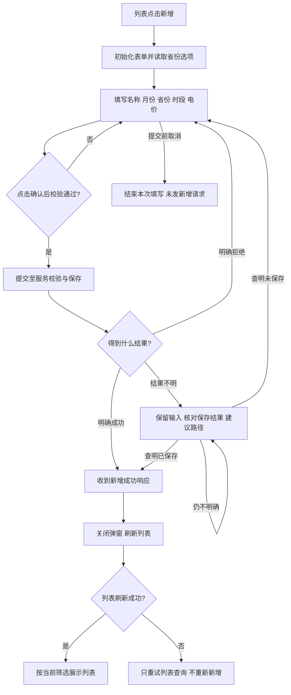

# 新增分时电价模板

## PRD 审核样稿 · v0.1 · 2026-10-13

**审核目标：**确认一项云平台功能的 PRD 是否已经把字段、交互、流程和异常展开到可以讨论开发实现的程度。

**文档状态：待产品审核，尚未作为开发交付版。**本稿依据用户提供的归档源码，选择其中现有“电价模板管理 → 新增模板”功能展开；没有运行归档工程、核实线上版本或改变程序。第 11 节列出仍影响实现口径的决定，不能把这些缺口交给开发自行选择。

本文采用三种标识：**【现状】**是本次静态读取到的行为，供产品确认是否沿用；**【建议】**是为补全交接而提出的候选规则，尚未批准、也不表示已实现；**【待确认 Dxx】**是尚未确定或资料冲突的业务决定。未标建议的规则、字段与验收依据均属于现状候选，整篇仍需审核。来源 S01～S14 见第 12 节。

## 1. 功能目标、范围与参与者

### 1.1 功能目标

用户建立一份可复用的分时电价模板，指定名称、省份、连续适用月份，以及一天内各时段的类型和电价。保存结果为“模板主信息 + 时段明细”。**创建模板成功不代表已配置到任何园区或电站，也不表示已下发到 EMS 或设备。**【现状，S03、S09】

### 1.2 本稿边界

| 项目 | 本稿说明 |
| --- | --- |
| 起点 | 用户进入电价模板管理列表，点击新增 |
| 本次展开 | 打开表单、填写基础信息、配置时段和电价、校验、提交、保存结果反馈、返回列表 |
| 终点 | 得到明确保存成功或明确失败的反馈；结果无法确定时进入待核对路径【建议，D07】 |
| 不在本稿内 | 模板编辑、复制、删除、批量配置、实际电价配置、历史账单重算、收益计算、设备调控 |
| 共享组件边界 | 源码复用“分时电价”弹窗；模板模式不显示“从模板导入”或“存为模板”选项，也不要求选择电站 |
| 业务状态边界 | 未发现此功能的草稿、审批、发布、生效状态。本文的填写中、提交中、结果待核对均是交互状态，不是新增业务审批流程 |

### 1.3 角色、前提与权限

| 参与者 | 职责与边界 |
| --- | --- |
| 模板维护用户 | 填写模板、处理校验提示、查看保存结果。哪些实际角色拥有新增权限待确认 D06 |
| 云平台页面 | 展示地区选项，编辑月份/时段/价格，执行界面校验，提交并显示结果 |
| 云平台业务服务 | 验证请求，关联当前租户，生成标识及审计信息，保存模板和明细 |
| 地区字典 | 提供省份编码与名称；用户选择省份，名称随编码带出 |

【现状】保存使用请求上下文中的租户和用户身份；用户不在新增表单填写租户、创建人或模板编号。【待确认 D06】当前角色名单、菜单权限、接口权限以及谁可以创建公共模板，不能仅由页面入口或租户特殊值推定。【建议】身份或租户上下文不可用时不得创建记录，保留未提交内容并提示重新建立有效会话；恢复会话后的草稿保留方式纳入 D06。

## 2. 页面组成与阅读顺序

【现状，S01、S02、S05】页面主入口为“电价模板管理”列表中的新增按钮。新增弹窗依次包含：模板名称、适用月份、归属地；一天的时段编辑区；覆盖完整性/价格提示；确认和取消按钮。弹窗外部遮罩不可点击关闭。

时段区用尖峰、峰、平、谷、深谷区分电价类型。用户为时间区间选择类型，再为已使用的类型设置价格。同一类型可以出现在多个不连续区间；当前页面让这些区间共享一个价格。

【建议】审核后的正式稿使用统一按钮名称“确认”“取消”，不在同一功能内混用“发布”“生效”。保存反馈要明确说“模板已保存”，避免误解为电站电价已生效。实际文案是否调整见 D09。

## 3. 业务对象与关系

| 对象 | 业务身份 | 关系、产生与使用 |
| --- | --- | --- |
| 电价模板 | 一份适用于所选省份和月份范围的日分时电价定义 | 一份模板包含一组基础信息和至少一条时段明细；保存后拥有独立模板 ID |
| 时段明细 | 一天内连续的一段时间及其价格类型、电价 | 每条明细只属于一个模板；所有明细按时间组合后覆盖 00:00～24:00 |
| 省份 | 模板的归属地区 | 用户从字典选一个省，编码和名称成对提交；不等于模板已绑定该省全部电站 |
| 当前租户 | 模板归属边界 | 从请求上下文取得；普通租户列表可见自身和公共模板。具体业务角色权限见 D06 |
| 实际电价配置 | 本功能之外的对象 | 后续其它操作可以使用模板；本次新增链路没有同步创建实际配置 |

【现状】名称不是模板 ID。归档设计允许重名，新增服务没有重名校验；是否沿用及同名辨识方式见 D01。本文不把“模板名称唯一”作为既有规则。

## 4. 功能数据与字段属性

### 4.1 模板输入字段

以下“可编辑”均指提交前；提交后的模板修改属于另外的编辑功能。

| 编号 / 字段 | 类型、含义与来源 | 必填 / 初值 / 可编辑 | 约束、关联与反馈 |
| --- | --- | --- | --- |
| F01 模板名称 name | 文本；用户给模板起的可读名称 | 必填；新增为空；可编辑 | 页面去除首尾空白，最多 64；字符集见 R01。归档设计长度 100，未见服务端统一限制，见 D01 |
| F02 省份编码 provinceCode | 字典标识字符串；来自所选省份 | 必填；新增未选；可搜索、清空、重选 | 不支持自由输入编码。提交时必须与 F03 配对；字典有效性/服务端复核见 D10 |
| F03 省份名称 provinceName | 文本；由 F02 对应的字典标签带出 | 必填；初始无值；不独立编辑 | 更改省份时同步更新；名称不能由用户输入覆盖。编码与名称不一致时的最终处理见 D10 |
| F04 起始月份 monthRange[0] | 年月 YYYY-MM；用户选择 | 必填；新增为空；可编辑 | 当前页面仅允许从本月到未来第 11 个月中选择；与 F05 构成连续区间，见 R02、D02 |
| F05 结束月份 monthRange[1] | 年月 YYYY-MM；用户选择 | 必填；新增为空；可编辑 | 不早于 F04，含首尾最多 3 个月；选择同月表示 1 个月；可跨年但须仍在可选窗口内 |
| F06 适用开始日期 applicateMonthStart | 日期字符串 YYYY-MM-DD；由 F04 派生 | 提交必有；无人工默认值；不独立编辑 | 起始月的 1 日，例如 2026-10 → 2026-10-01 |
| F07 适用结束日期 applicateMonthEnd | 日期字符串 YYYY-MM-DD；由 F05 派生 | 提交必有；无人工默认值；不独立编辑 | 结束月的实际最后一天，例如 2026-12 → 2026-12-31；真实日期校验和首尾日口径见 D02 |
| F08 时段明细 items | 明细集合；由时间编辑区转换 | 至少 1 条；新增为空；提交前可调整 | 每条满足 4.2，各条共同满足 R04。存在任何空隙、重叠或缺价格时不提交 |

### 4.2 每条时段明细的属性

| 编号 / 字段 | 类型、单位与含义 | 必填 / 初值 / 来源 | 约束与联动 |
| --- | --- | --- | --- |
| F09 时段类型 periodType | 枚举；该区间所属电价类型 | 每段必填；添加区间时选择 | 1 尖峰、2 峰、3 平、4 谷、5 深谷。模板链路不支持“无”档；不是每个模板都必须使用五类 |
| F10 开始时间 startTime | 日内时间 HH:mm，无日期 | 每段必填；用户配置，不预填全天 | 页面合法开始为 00:00～23:30，每次 30 分钟；不得等于或晚于结束；服务端粒度差异见 D04 |
| F11 结束时间 endTime | 日内时间 HH:mm | 每段必填；用户配置 | 页面合法结束为 00:30～24:00，每次 30 分钟；24:00 表示该日结束，不是可作为开始的时间 |
| F12 电价 price | 十进制金额含义；元/kWh | 每个已使用类型必填；初始实际为 null | 页面允许 0～3，含边界；最多 6 位小数，超出截断不四舍五入。占位 0.000000 不表示默认值 0。最终精度/上限见 D03 |
| F13 顺序 sort | 整数；明细排序辅助值 | 系统产生；用户不直接填写 | 页面按开始时间排序后提交；服务按接收顺序赋 0、1、2…；顺序不改变时间本身或电价含义 |
| F14 模板关联 templateId | 模板标识 | 保存后由系统赋值 | 所有新明细均关联本次新建的模板；不允许页面选另一个模板 ID |
| F15 明细 ID id | 记录标识 | 保存后产生 | 新增时不要求用户提供；作为明细身份，不作为时间顺序 |

【现状，S04、S05】界面可存在“某类型已设置价格但没有区间”的本地值；没有区间的类型不会产生提交明细。一个类型最后一段被删掉后，未使用的价格不应被理解为新增了一条电价记录。是否保留该价格供本次继续编辑使用见 D05。

### 4.3 模板系统字段及列表回显

| 编号 / 字段 | 来源与初始行为 | 可见性、修改性与约束 |
| --- | --- | --- |
| F16 模板 ID id | 整数标识，源码 Long；主记录保存时产生 | 新增响应返回；用户不可填写或修改；同名模板仍是不同 ID |
| F17 模板编码 code | 字符串 String；服务端生成 | 独立于名称；用户不可填写；归档设计有唯一索引，实际数据库约束未验证 |
| F18 租户 tenantId | 整数标识 Long；来自当前请求上下文 | 缺失时服务报错；用户不能通过表单指定他人租户；公共模板权限见 D06 |
| F19a 创建用户标识 createUser | 字符串 String；来自 user_id | 系统只读；读取方法可能返回 null，是否强制完整身份见 D06 |
| F19b 创建用户名 createUserName | 字符串 String；来自 username | 系统只读；可能为 null；列表缺值显示 --；不能直接称为真实姓名 |
| F19c 更新用户标识 updateUser | 字符串 String；新增时与 createUser 相同 | 系统只读；空值边界同 F19a；后续编辑更新不在本稿范围 |
| F19d 更新用户名 updateUserName | 字符串 String；新增时与 createUserName 相同 | 系统只读；空值边界同 F19b |
| F20a 创建时间 createTime | 日期时间，源码 Date；服务端产生 | 新增赋值；只读；列表按 YYYY-MM-DD HH:mm:ss 展示，时区见 D02 |
| F20b 更新时间 updateTime | 日期时间，源码 Date；新增时与 createTime 为同一个时刻 | 新增赋值；只读；后续编辑更新不在本稿范围 |
| F21 删除标记 deleted | 整数 Integer；新增为 0，表示未删除 | 不在新增页编辑；不等于“已生效”或“已审批” |
| F22 适用范围、价格摘要 | 由 F06/F07 与时段数据计算 | 列表只读展示；摘要按尖峰、峰、平、谷、深谷顺序列使用类型的电价 |

**明确排除：**实体中有市编码、市名称、备注等预留字段，但当前新增请求和界面不提供这些输入；本稿不增加这些表单项。省编码长度 32、省名称 64、日期字符串 16 是归档 DDL 的存储设计，不能当成已验证的线上业务校验；见 S11、D10。

## 5. 业务规则与校验

| 规则 | 业务说明 | 触发、结果与依据 |
| --- | --- | --- |
| R01 名称 | 去除首尾空白后不能为空。页面允许一～龥范围的汉字、英文字母、数字、下划线、连字符、点，以及 、，。．·（）()：: 和空白字符；其它字符被拒绝 | 输入及提交校验；名称上限、空白字符细则、重名决定 D01。S02 |
| R02 月份 | 至少选择 1 个月，连续且含首尾最多 3 个月；可选窗口为页面当前月至当前月 +11 月 | 例如按 2026-10 为当前月，可选 2026-10～2027-09；2026-12～2027-02 为连续 3 个月。这是日期固定的说明例子，非永久可选值。S06；D02 |
| R03 类型 | 明细类型必须属于五档；允许类型重复出现，不要求五档齐全 | 非法类型不得保存；只有一个类型覆盖全天也可以。S04、S09、S10 |
| R04 全日覆盖 | 将所有明细按开始时间排序，第一段从 00:00 开始，相邻段首尾相接，末段到 24:00；无空隙、无重叠、无零时长 | 输入改变后实时反馈；提交前再次校验；失败保留已填内容。S04、S09 |
| R05 时间粒度 | 当前页面以 30 分钟为步长；单段结束严格晚于开始。22:00～次日 06:00 不能是一条，应拆成日内两条再与其它时段覆盖全天 | 服务端只校验到分钟，未落实 30 分钟倍数；待决定 D04。S04、S05、S09 |
| R06 价格 | 每个已使用类型必须有价格；0 是有效输入，空值不是 0。页面 0～3、6 位截断；按类型设置价格会影响该类型所有区间 | 价格输入及提交校验；精度、范围、同类型同价需统一，见 D03、D05。S02、S04、S05 |
| R07 区间边界 | 【建议】日内区间采用左闭右开，例如 07:00 属于从 07:00 开始的区间；24:00 仅作为本日上界 | 当前校验只能证明连续，不能证明计价边界口径。待确认 D04；本稿不扩展实际账单计价 |
| R08 保存范围 | 只保存模板主信息和明细，不自动应用到电站、生成账单或触发控制 | 成功反馈应保持此边界。S03、S09 |
| R09 保存完整性 | 服务有主从保存事务声明；【建议】业务成功须同时满足主信息与全部明细保存完整，任一步失败不得留半份模板 | 事务声明已见，故障验证未运行；服务未逐项处理保存布尔结果。D11，S09 |
| R10 保存与刷新 | 保存响应成功后关闭弹窗并刷新列表；刷新是另一次操作 | 刷新失败不应重新新增；保留筛选与页码时新记录可能不可见。D08，S01、S02、S14 |

【建议】确认后的必填、枚举、范围、精度与跨字段规则应在服务端同样有效；界面限制不应成为唯一保障。现状差异已纳入对应 D 编号，本稿不假定当前后端已经具备全部规则。

## 6. 交互逻辑

### 6.1 从打开到提交

| 交互 | 用户动作 / 条件 | 页面响应、数据变化与可继续操作 |
| --- | --- | --- |
| I01 打开 | 列表点击新增 | 打开模板模式弹窗；名称、月份、省份、区间为空，各类型价格为 null；不带电站，不默认填全天。S01、S02 |
| I02 选省份 | 搜索、选择或清空省份 | 展示字典名称，内部同时持有编码；清空后必填校验不通过；不改变已配置时段。S02 |
| I03 选月份 | 选择起始月和结束月 | 展开连续月份；超出窗口或超过 3 个月不能作为有效区间；清空后需要重新选择。S06 |
| I04 配置时段 | 在某类型行中设置时间区间 | 时间块表示该区间；新增、移动或调整后重新计算全日覆盖；具体手势见下文。S05 |
| I05 配置价格 | 在时间块的价格入口输入 | 修改该类型共享价格，所有同类型时间块同步显示；不改其它类型。空值不能被占位符替代。S02、S05 |
| I06 查看校验 | 修改时间块或价格 | 全天覆盖且已使用类型有价时显示通过提示；否则展示当前校验错误。当前校验顺序先时间覆盖，后缺失价格。S02 |
| I07 点击确认 | 用户要求保存 | 先校验名称、省份、月份，再校验时段及价格；失败停留弹窗且不发新增请求；通过后确认按钮进入 loading。S02 |
| I08 成功 | 收到明确成功响应 | 当前页面提示操作成功，关闭弹窗并刷新原列表；【建议】文案用“模板已保存”。新记录是否定位到当前页见 D08。S01～S03 |
| I09 明确失败 | 服务返回明确业务错误 | 当前页面显示服务消息，缺省显示操作失败，弹窗保留、loading 结束；用户按错误修改后再提交。S02 |
| I10 未提交取消 | 发请求前点击取消或关闭 | 当前组件关闭弹窗，本功能未见弃稿确认；重新从新增进入按空白表单初始化。【建议】有修改时询问是否放弃本次填写。D09 |
| I11 提交中关闭 | 请求发送后点击取消/关闭 | 当前调用只设置确认按钮 loading，未见业务层取消请求；不能承诺关闭就未创建。【建议】提交中禁止再次提交及关闭，直至明确结果或进入结果待核对。D07 |
| I12 超时/断网 | 请求已发出但无明确结果 | 本功能未定义完整恢复路径。【建议】保留表单，提示“保存结果待核对”，不自动重新新增；先核对服务端是否已保存。核对依据与恢复操作见 D07 |
| I13 字典失败 | 省份选项无法取得 | 当前实现返回空选项，表单无法完成有效省份选择；【建议】显示失败原因和重试入口，重试不清空其它输入。D10 |

### 6.2 时段编辑的操作约定

【现状】编辑区以 30 分钟作为时间对齐单位，支持时间块添加、移动、边界调整和删除，操作后统一进入全日覆盖校验。不同类型的时间区间同样参与重叠校验，不能各行单独覆盖 24 小时。

| 操作 | 明确的响应与限制（S05） |
| --- | --- |
| 空白处单击 | 在该类型行尝试创建 1 小时时段；空间不足尝试 30 分钟；仍无法合法放置则不创建。创建成功打开价格小窗 |
| 空白处拖动 | 创建按 30 分钟对齐的区间；不能超出日界或与任意类型的现有区间重叠 |
| 拖动时间块 | 保持时长整体移动；冲突位置不能应用，不覆盖其它时间块 |
| 拖动左右边界 | 改变对应开始或结束；最短 30 分钟；超出日界或导致重叠的调整不应用。合法缩短留下空隙时，覆盖校验转为不通过 |
| 点击时间块 | 打开对应价格小窗；输入修改的是价格草稿，应用后才同步该类型所有时间块 |
| 小窗点击确认 | 空值或越界留在小窗并提示；合法值应用到本地类型价格，然后关闭。此时尚未请求模板保存 |
| 小窗关闭、点击外部或切换色块 | 合法草稿也会应用；非法或空草稿不应用，原有类型价格保留。新类型原本未配价则仍未配价 |
| 删除区间 | 色块或价格小窗的删除直接删除该段，无二次确认；重新计算覆盖。其它区间保留，类型价格不会随最后一段删除而自动清空 |

【现状，S06】月份面板禁选超跨度月份，选择完成的后备处理还会把超过 3 个月的范围收窄至 3 个月；不能把这个特殊分支写成总是报错。是否保留自动收窄或改为明确提示，也需要在 D02 中决定。

**【待确认 D05】价格编辑小窗的“关闭”含义需要特别审核：**现有组件会把合法价格提交到本地表单，关闭不等于撤销价格修改。建议调整为“确认=应用、取消=恢复打开前值”的明确语义；是否增加取消入口并调整关闭行为由产品确认。这个本地应用操作不等于已保存模板。

【现状】时间块创建/移动/边界调整不会应用重叠位置；合法操作留下的空隙由覆盖校验提示并阻止提交。键盘可用操作、手机触摸方式不是本次已核实能力；本稿先覆盖现有桌面配置路径，不据源码宣布跨设备验收通过。

## 7. 业务流程

### 7.1 主流程与分支图

图中“结果待核对”为建议路径，对应 D07；其余主链依据现状整理。“收到成功响应”不代替数据库完整性验证，主从完整保存的成功定义与故障验收见 D11。

### 7.2 步骤、输入输出与数据变化

| 步骤 | 执行者 / 触发 | 输入、处理及输出 | 后续与异常 |
| --- | --- | --- | --- |
| B01 建立上下文 | 用户点击新增；页面 | 初始化空表单，取得省份选项；保留当前列表上下文 | 进入 B02；身份、字典异常分别按 D06、D10 |
| B02 编制模板 | 用户编辑 | 写入 F01～F05；配置 F09～F12；派生月份范围和明细集合 | 随时运行局部校验；提交前取消则不发保存请求 |
| B03 提交前校验 | 用户点击确认；页面 | 校验必填、字符、月份、全天覆盖和价格；成功形成完整提交快照 | 任一失败回 B02并提示，不创建记录 |
| B04 数据转换 | 页面 | F04/F05 转月首/月末；各类型区间展开为明细，每段带类型和对应价格；按开始时间排序 | 不提交无区间的类型；继续 B05 |
| B05 服务校验 | 业务服务收到请求 | 复核名称、省份、日期格式/先后、类型、非负价格、全天覆盖；读取当前租户 | 拒绝返回明确业务错误；前后端差异见第 11 节 |
| B06 保存 | 业务服务 | 生成模板 ID/编码及审计字段；保存主信息和全部关联明细；返回 ID | 有事务声明；完整失败语义见 R09/D11，不把声明当故障验证 |
| B07 反馈 | 页面收到响应 | 成功→提示并关闭；明确拒绝→保留输入；无明确结果→建议进入待核对 | 无明确结果不得直接标“未保存”，也不得直接重试创建 |
| B08 列表回读 | 页面发出独立列表查询 | 使用当前筛选和页码重新读取；列表显示名称、省份、日期范围、价格摘要、创建人/时间 | 查询成功未出现新行不等于未保存；失败只重试查询 |

### 7.3 异常与恢复

| 场景 | 纸面必须明确的结果 | 状态及依据 |
| --- | --- | --- |
| 必填或覆盖校验失败 | 指出具体错误，保留输入；不请求新增 | 当前已有前置校验；S02、S04 |
| 服务明确业务拒绝 | 展示原因，停留表单；修正后允许再次提交 | 当前页面有该分支；S02、S09 |
| 省份字典失败 | 【建议】说明无法加载并允许重试，不用编码猜名称、不清空其它字段 | D10，现有业务恢复不足 |
| 保存超时或断网 | 【建议】结果待核对；不自动重试创建；未查明前不能确认“未创建” | D07，幂等和查询匹配未确定 |
| 保存成功但列表失败 | 【建议】提示“模板已保存，列表刷新失败”，提供刷新列表；不重复新增 | D08；保存与查询已有独立调用 |
| 保存成功但筛选隐藏记录 | 【建议】提示已保存且当前筛选可能隐藏记录；保留用户筛选，提供按返回 ID 查看本次结果 | D08；精确查看方式需要确认，不声称页面已有 |
| 提交中退出或重复点确定 | 【建议】禁止重复提交和退出；若请求已发出仍需等待/核对结果 | D07；按钮 loading 不能证明请求幂等 |
| 主从保存任一步失败 | 【建议】整份模板失败，不留主表或残缺明细；必须用故障场景验收 | D11；本轮未运行保存或故障注入 |

## 8. 交互状态与转换

以下是交接分析用的状态名称，不要求新增数据库状态字段。

| 状态 | 进入条件 | 允许的下一步及结果 |
| --- | --- | --- |
| U0 列表中 | 尚未打开新增或新增结束 | 点击新增进入 U1 |
| U1 填写中 | 新增打开、校验失败或服务明确拒绝 | 修改输入；校验通过并提交进入 U2；提交前取消回 U0 |
| U2 提交中 | 新增请求已发送 | 明确成功进入 U3；明确拒绝回 U1；结果不明进入建议状态 U4。关闭和重复提交限制见 D07 |
| U3 已确认保存 | 收到明确成功结果 | 关闭弹窗并刷新列表；刷新失败仍维持“已保存”事实，不回到未创建状态 |
| U4 结果待核对【建议】 | 未收到明确保存结果 | 查明已保存→U3；查明未保存→U1；不能确定→继续保留未决状态。具体核对方式待 D07 |

“字段全部合法”只是可以请求保存；“按钮 loading 消失”不等于保存成功；“列表没有该行”也不等于保存失败。模板创建不产生实际电价配置的生效状态。

## 9. 一组完整的审核示例

**以下为合成示例，不是真实电价、业务批准值或已执行结果。**假设页面当前月份为 2026-10，用户在地区字典中选择一个有效省份；编码与名称沿用该选项，不在文档里虚构真实省编码。

| 属性 | 样例输入 / 预期表达 |
| --- | --- |
| 名称 | 样稿审核用模板-2026年10至12月 |
| 适用月份 | 2026-10～2026-12，共 3 个月 |
| 派生日期 | 2026-10-01～2026-12-31 |
| 归属地 | 地区字典中选定的省编码、对应省名称 |
| 价格精度 | 下列价格均不超过 4 位小数，避免用成功样例掩盖 4/6 位冲突 |

| 顺序 | 日内区间 | 类型 | 单价（元/kWh） |
| --- | --- | --- | --- |
| 0 | 00:00～07:00 | 谷 | 0.4 |
| 1 | 07:00～11:00 | 峰 | 1.2 |
| 2 | 11:00～14:00 | 平 | 0.8 |
| 3 | 14:00～17:00 | 峰 | 1.2 |
| 4 | 17:00～21:00 | 平 | 0.8 |
| 5 | 21:00～24:00 | 谷 | 0.4 |

整天被连续覆盖；使用峰、平、谷三类即可，不要求额外补尖峰和深谷。页面在峰类型任意区间把价格改成 1.3 时，两个峰时段同步变成 1.3；平、谷不变。保存提交包含 1 份模板主信息与上述 6 段明细，不包含“未使用类型价格为 0”的额外明细。

若把第 2 段起点改为 07:30，则产生 07:00～07:30 的空隙，整体校验失败，修正前不发送新增请求；若尝试拖到 06:30，则与第 1 段重叠，该冲突调整不应用。绕过界面直接提交重叠明细时，服务端应按已见覆盖校验拒绝。若保存已返回成功但列表当前筛选的是其它省份，不能用“未看到新行”判断保存失败。

## 10. 验收条件（待审核，未执行）

“现状候选”表示可据源码整理成测试预期，仍需产品确认；“待决/建议”必须先解决对应 D 项再成为正式验收。下表没有任何“已通过”的测试结论。

| 编号 | 前提与动作 | 可观察结果 | 身份 / 关联 |
| --- | --- | --- | --- |
| AC01 | 从模板列表点击新增 | 名称、省份、月份和时段为空；价格未填；无电站、“存为模板”“从模板导入”输入 | 现状候选；F01～F12，I01 |
| AC02 | 必填项为空或名称全空白，点击确认 | 留在弹窗并显示相应校验；不发新增请求 | 现状候选；R01、I07 |
| AC03 | 在固定当前月 2026-10 条件下选择 2026-12～2027-02 | 是连续 3 个月；派生 2026-12-01～2027-02-28；不丢失年份 | 现状候选；R02，最终以 D02 确认口径为准 |
| AC04 | 尝试过去月份、窗口外月份或连续 4 个月 | 当前选择器不接受为有效选择；服务端一致拒绝需另确认实现 | 现状候选 + 待决；D02 |
| AC05 | 使用第 9 节完整样例 | 全日覆盖通过；形成 6 条明细，不补未用类型 | 现状候选；R03、R04 |
| AC06 | 尝试重叠或零时长调整，再分别制造空隙、空时段集或末段不到 24:00 | 冲突/零时长调整不应用；可形成的空隙/未覆盖状态阻止提交；直接提交非法明细由服务拒绝 | 现状候选；R04、R05 |
| AC07 | 将唯一一种类型设置 00:00～24:00 且填合法价格 | 不因缺少另外四类而拒绝 | 现状候选；R03、R04 |
| AC08 | 新建尚未配价类型覆盖全天；随后在小窗输入 0 并确认；再清空该小窗草稿 | 未配价时模板不能提交；应用 0 后可通过价格校验；空草稿不能确认，关闭后已应用的 0 保留，不变成未配价 | 现状候选；F12、R06、6.2 |
| AC09 | 两个不连续峰时段，修改其中价格入口 | 两个峰时段电价同步，其它类型不变；请求各峰明细同价 | 界面现状候选；服务端保障待 D05 |
| AC10 | 输入 0.1234567、3、3.000001 和负数 | 页面按 6 位截断并约束 0～3；端到端保存后精度及越界错误需 D03 决定 | 待决；不能以界面显示代替存储精度验收 |
| AC11 | 输入非法类型或非 30 分钟边界请求 | 非法类型服务已拒绝；30 分钟约束在服务侧的预期待确定 | 现状候选 + 待决；D04 |
| AC12 | 合法保存得到成功响应 | 返回新模板 ID，主信息及全部明细关联一致；不会产生电站电价配置或设备指令 | 现状候选；R08、B06；数据核查未运行 |
| AC13 | 新增已成功，随后列表查询失败或筛选隐藏新行 | 不再次新增；明确展示保存与回读的不同结果 | 建议；D08 |
| AC14 | 提交前取消，再重新点击新增 | 前一次未发新增；重新进入是空白新增。弃稿确认文案另按 D09 | 现状候选 + 建议；I10 |
| AC15 | 保存中重复点击、关闭或出现网络超时 | 不将未知结果标失败并自动重建；按统一核对路径处理 | 建议；D07 |
| AC16 | 不具备新增权限或租户上下文无效 | 不产生记录；页面提示、接口拒绝和草稿恢复按确认矩阵一致执行 | 待决；D06 |
| AC17 | 地区字典失败或编码/名称不匹配 | 不保存错误省份；重试字典不丢其它输入，服务按确认规则拒绝或纠正 | 建议；D10 |
| AC18 | 主信息或明细保存发生失败 | 不返回完整成功、不留半份模板；查库与返回一致 | 建议；D11；事务故障测试未运行 |

## 11. 产品审核决定清单

下面逐项注明要确认的内容，避免把“待确认”留成无法行动的一句话。D01～D11 均会影响本功能实现或验收；全部解决并回填正文后，才能将本样稿转为开发交付版。产品负责业务口径，研发负责核实实际约束与可实现性；本稿没有代替任何一方确认。

| 决定 | 已见事实 / 差异 | 建议或需要你确认的内容 | 影响 |
| --- | --- | --- | --- |
| D01 名称 | 页面上限 64、字符白名单和 trim；归档设计长度 100且允许重名；服务未统一长度/字符校验 | 建议沿用页面 64，允许重名并以 ID 区分；是否限制内部空白为普通空格、同名记录如何辨识需确认。若选 100，需同步页面和服务规则 | F01、R01、AC02 |
| D02 月份与时区 | 页面本月起 12 个月内选最多连续 3 个月，后备处理自动收窄超跨度；服务仅日期正则和先后 | 是否沿用窗口/跨度、禁止历史月及自动收窄？首尾日期是否包含？“本月”和审计展示采用什么时区/时钟？建议服务校验真实日历日期及月首/月末 | F04～F07/F20、R02、AC03～04 |
| D03 价格 | 页面 0～3、6 位截断；Java Double；归档 DDL 为 DECIMAL(10,4)；实际库未核对 | 请确认业务上限与统一小数位，超位是拒绝、截断还是舍入。建议产品确认 6 位输入是否必要后，再由研发核对实际存储，不能默认接受精度损失 | F12、R06、AC08/10 |
| D04 时间 | 页面 30 分钟；服务可接受分钟；代码未定义相邻边界计价归属 | 是否统一 30 分钟？建议采用日内左闭右开、24:00为上界，单段不跨日；是否批准这些约束及服务端一致校验 | F10～F11、R05/R07、AC06/11 |
| D05 同类价格与本地编辑 | 页面同类型共享价格，服务未限制同类型同价；小窗关闭也可能应用价格 | 是否强制同类型同价？建议小窗“确认应用、取消还原”；删除最后一段后是否保留该类型价格供本次编辑复用 | F12、R06、I05、AC09 |
| D06 权限 | 归属取租户上下文；源码不足以还原业务角色矩阵 | 明确哪些现有角色可新增私有/公共模板，谁能选择公共租户；失效会话后的输入保留和恢复方式。不得用“管理员可操作”替代具名角色与范围 | 角色、F18～F19、AC16 |
| D07 重复与未知结果 | 请求中只看到确认按钮 loading；后端未见幂等键；关闭不取消已发请求 | 建议提交中限制关闭/重复提交、不自动重试新增；结果未知如何精确查证、何时允许重试必须与研发确定，不能只按同名搜索后认定成功 | I11～I12、U4、AC15 |
| D08 保存后展示 | 成功后刷新原列表，保留筛选/页码，可能看不到新记录 | 建议保留筛选并明确提示隐藏情况，按返回 ID 定位本次结果；列表刷新失败只重查。是否需要精确查看入口及文案请确认 | F22、R10、I08、AC13 |
| D09 取消与文案 | 未见未保存修改的弃稿确认；现有成功文案较通用 | 是否采用“有修改才确认放弃”；成功明确为“模板已保存”，避免误解为电站生效 | I08/I10、AC14 |
| D10 省份 | 页面字典选择；失败返回空；服务检查非空但未核对编码有效性和名称匹配 | 确认可用地区范围；建议编码为依据，名称从同一字典取值；无效/失效编码拒绝，字典失败可重试且保留其它填写 | F02～F03、I13、AC17 |
| D11 完整保存 | 有事务声明，保存布尔结果未作完整分支处理；未核查数据库运行状态 | 建议以“主信息与全部明细完整保存”作为成功条件。产品确认不接受半份模板；研发核查事务/返回/故障场景，形成可执行验收 | R09、B06、AC12/18 |

审核时可按编号回复“沿用现状”“接受建议”或给出替代规则。对有多个决定点的 D 项，可以逐点回答；没有回答的部分继续保留为未决，不会自动认定采纳整项建议。

## 12. 依据、追溯与本次核查范围

### 12.1 来源身份

源码目录是用户授权的 `D:\99_归档\云平台代码`。本稿读取日期为 2026-10-13；前端与后端为本机归档快照，不是线上版本证明。活动共用知识包 `energy-cloud-source-20261013-v5` 用于定位电价模板模块；本稿进一步沿新增链路直接读取文件，新的观察没有自动发布到共用知识包。

下面用源码根目录缩写减少正文干扰：

- **WEB** = `D:/99_归档/云平台代码/zhny-cloud-web-new/src/`
- **BE** = `D:/99_归档/云平台代码/ytp-后端/cnzhny/src/main/java/com/cloud/zhny/business/`
- **BDOC** = `D:/99_归档/云平台代码/ytp-后端/cnzhny/docs/`

### 12.2 本次直接核对的证据

| 来源 | 文件与位置 | 支持范围 |
| --- | --- | --- |
| S01 | WEB `views/electricity-price/price-template/index.vue`，1～16、123～125 | 新增入口、模板模式、成功后 reload |
| S02 | WEB `views/electricity-price/price-config/components/EditNormalPriceModal.vue`，23～123、156～169、310～327、345～401、527～590 | 表单、名称、初始数据、校验、数据组装与保存反馈 |
| S03 | WEB `views/electricity-price/price-template/api.ts`，18～34、85～119、122～165、203～212 | 枚举、扁平数据到明细、月份到日期、新增请求 |
| S04 | WEB `views/electricity-price/price-template/tariffTimeline.ts`，3～16、19～33、44～95、146～181 | 时间粒度、价格截断、全天覆盖校验 |
| S05 | WEB `views/electricity-price/components/TariffTimeline.vue`，97～110、195～199、283～315、340～355、398～452、515～563、575～634 | 时间块手势、价格范围与小窗草稿/应用行为 |
| S06 | WEB `views/electricity-price/components/MonthRangeSelect.vue`，23～42、64～125 | 当前月窗口、连续选择、最多 3 个月与后备收窄 |
| S07 | WEB `views/electricity-price/price-template/priceTemplate.data.ts`，9～20、26～69、116～172 | 类型、列表价格摘要、适用范围与创建信息 |
| S08 | BE `controller/ElectricPriceTemplateController.java`，32～55；`domain/request/electric/ElectricPriceTemplateRequest.java`，19～35；`ElectricPriceTemplateItemRequest.java`，18～28（同目录） | 新增接口、返回 ID、请求字段 |
| S09 | BE `service/impl/ElectricPriceTemplateServiceImpl.java`，58～80、93～114、184～216、219～303、315～329 | 查询归属、主从保存、系统字段、业务校验 |
| S10 | BE `common/enums/PeriodTypeEnum.java`，8～12、30～39；`domain/entity/ElectricPriceTemplate.java`，29～99；`ElectricPriceTemplateItem.java`，27～53（同目录） | 枚举、主从对象、系统字段 |
| S11 | BDOC `requirements/REQ-0030-electricity-price-template/02_design.md`，3、27～45、51～83 | 归档设计身份；重名、长度与价格 4 位 DDL；不证明实际部署 |
| S12 | BDOC `requirements/REQ-0034-electricity-price-template-user-name/02_design.md`，23～24、29～31、40～42；BE `utils/SessionUtils.java`，9～32 | 审计名称来自 username，不等于真实姓名 |
| S13 | WEB `router/routes/modules/electricity-price.ts`；`router/routes/modules/control-strategy.ts` | 不同路由入口线索，不能代替实际角色权限证明 |
| S14 | WEB `components/Table/src/hooks/useDataSource.ts`，226～245、312～313 | 列表 reload 保留当前查询/分页上下文 |

### 12.3 本轮完成与未验证

已完成：范围内源码和归档设计静态核对、字段到规则/流程/验收的对应整理、差异与未决决定逐项标注。[随稿源码核对记录](D:/01_AI工程/01_工程项目/pm-req/docs/prd-samples/新增分时电价模板-源码核对记录-20261013.json)保存读取文件的 SHA-256 和位置，便于后续更新核对。

未执行：归档云平台运行、页面真实操作、前后端联调、数据库字段/迁移验证、保存与回滚测试、权限验证、产品经理业务确认。本稿所有验收条目均是待审核预期，不是测试通过报告。

本次仅新建样稿和阅读附件，不修改应用代码、原始源码、现有项目数据或共用知识包。正式交付前，将第 11 节决定回填相应字段/规则/流程/验收，完成跨章节核对，并由产品经理确认文档版本。
