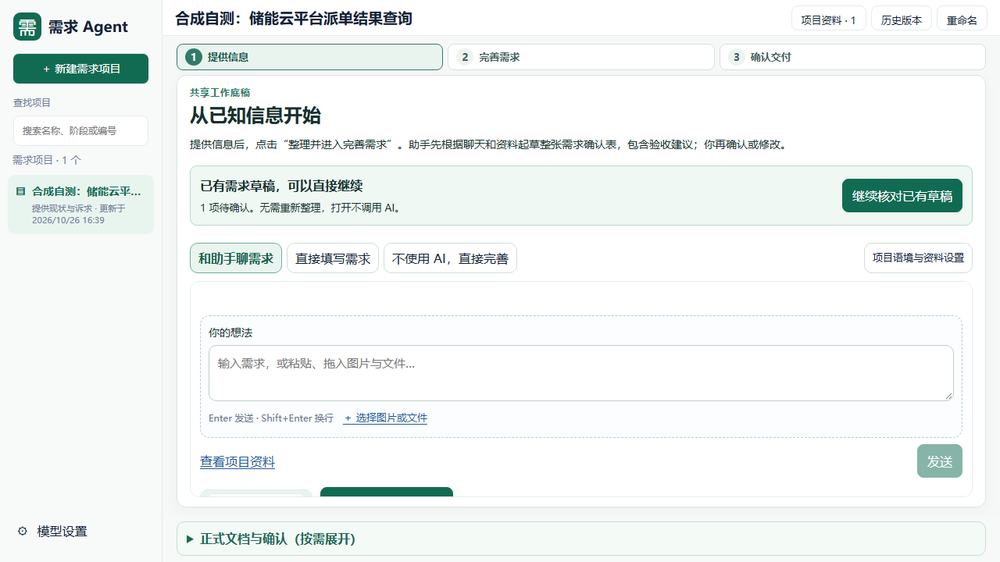
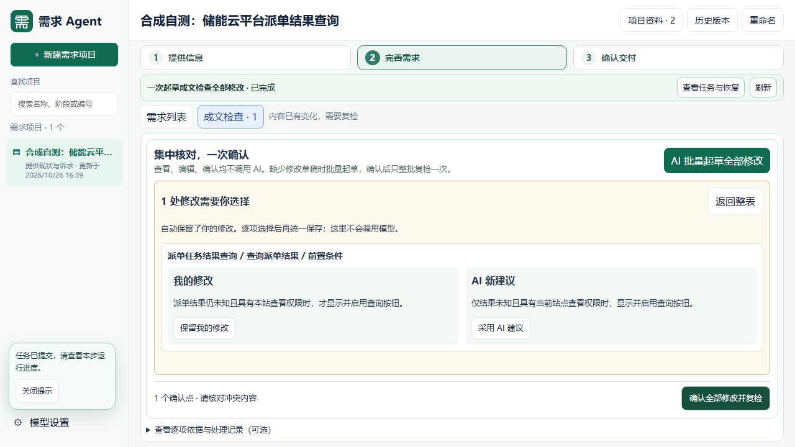
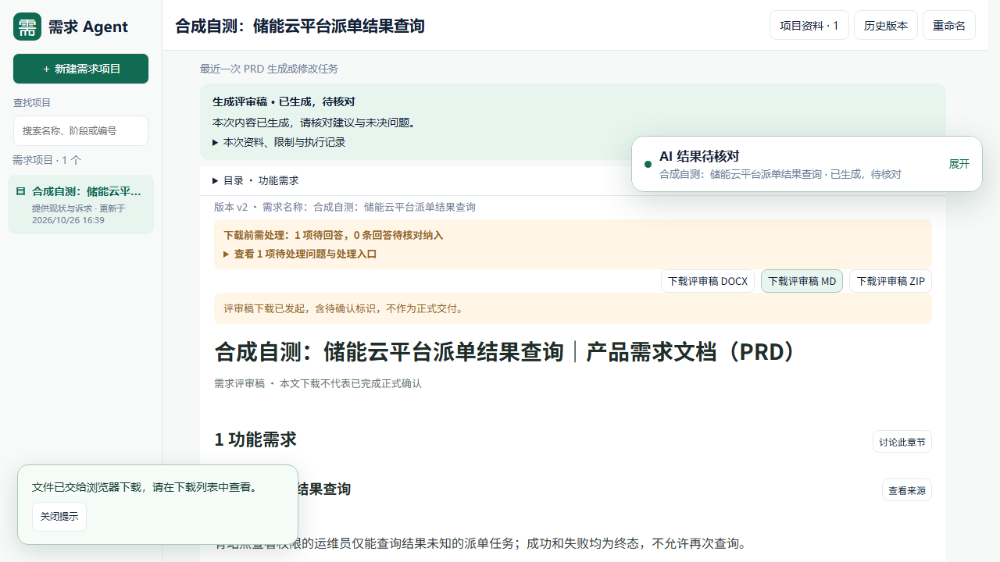

# 成文冲突处理与 PRD 用户验收（2026-10-26）

## 验收结论

按使用者操作顺序，在 1280×720 浏览器中完成冲突发现、整批起草、原地比较、统一确认、整批复检、PRD 展示及下载。六组冲突场景均通过。原来的流程存在真实阻塞，不能仅凭按钮显示或单元测试视为可用；本次修复并复测了这些阻塞。

当前打开已有项目仍先进入需求助手。已有草稿会显示“继续核对已有草稿”，点击只查看，不重新整理、不调用模型、不修改项目数据。

## 用户实际怎么处理

1. 已有推荐与回答在同一张表里核对。不满意的内容直接修改。
2. 缺少草稿时，点击“AI 批量起草全部修改”，核对范围后运行一次。
3. 人工编辑与新建议有差异时，同一区域并排显示“我的修改 / AI 新建议”。逐处选择“保留我的修改”或“采用 AI 建议”；选择过程不调用模型、不立即保存。
4. 点击“确认全部修改并复检”，整批保存后运行一次整批复检。缺项会原地展示业务名称与输入框，按钮可点击校验。补齐后继续点击同一个确认按钮。
5. 复检通过后点击“返回并继续生成 PRD”，运行文档任务，核对正文与下载结果。若发现新的冲突，仍在同一张表继续处理，已落实的回答保留。

暂时不能确定业务口径时，可以点击“先生成待确认评审稿”。当前有效检查中的未决业务点会随 PRD 保留，下载明确标注非正式交付；不会替用户决定。检查失败、过期、来源错误或硬性结构问题不能用此入口绕过。正式交付仍需处理未决点并完成相应确认。

## 浏览器验收结果

| 场景 | 实际验证 | 结果 |
| --- | --- | --- |
| 回答已保存、正文仍矛盾 | 已有回答沿用，整批修正文与交互，复检、生成并下载 PRD | 通过 |
| 人工与 AI 同时改同一前置条件 | 比较后保留人工版本，PRD 精确保留该版本 | 通过 |
| 人工与 AI 同时改同一前置条件 | 比较后采用 AI 版本，PRD 使用所选版本 | 通过 |
| 用户改为其他明确口径 | 查询超时 10 秒改为 20 秒；原验收按身份修订，未留下互相矛盾的旧条款 | 通过 |
| 第一轮处理后仍有另一处冲突 | 第二轮继续处理响应权限问题；已落实回答不丢失，最终生成并下载 PRD | 通过 |
| 暂不能决定 | 直接生成带未决点的评审 PRD、下载评审 MD；正式 DOCX 请求被拒绝（409） | 通过 |

以上使用冻结的合成储能云派单查询资料与可检查实际正文的离线模型响应，非真实业务规则。所有浏览器场景核对最终渲染的字段表、交互表、流程图、正文和实际下载文件；不是只检查任务状态。页面无脚本异常，日常数据指纹保持一致。

另外，在 BMS 修订 50 的本机隔离副本上，未重新起草就复现两项可选值缺项：按钮能点击并原地标红；输入多值不中断；三个笔记本视口操作可见可点；确认前零写入、零模型调用；一次提交与一次整批复检通过。填入的枚举仅用于隔离验证，未写回真实 BMS 项目，也未向模型外发其资料。

## 修复范围

- 详细定义的冲突选择接入集中表格，明确保留人工内容或采用建议。
- 验收修订通过模型协议中明确的目标引用更新原条款；跨需求、猜测或重复目标不接受。
- 第二轮操作不再复用已经采纳过的旧候选身份；未采纳的失效建议仍会拦截。
- 等待用户确认时，浮动进度卡不再遮挡当前表格的继续操作。
- 单纯打开已有草稿不再创建材料或使原检查失效。
- 缺项填写即时显示剩余数量，填好后不需要猜测按钮是否可用。
- 结果枚举中的“结果未知三选一”不再被误识别为已经发生的未知结果；真实超时、未知事件的语义约束保留。
- PRD 引用程序完整成文的详细定义时，模型重复解释若违反既有排版协议，可本机恢复为章节条款引用：原需求、字段、交互、流程和状态按已确认原文完整成文；重复模型段落及恢复证据保留。不采用删除引用后仍保留无依据叙述的做法，其他无效引用继续严格检查。

## 真实模型验证及边界

复用已获准配置的 DeepSeek 官方 deepseek-flash，仅发送上述合成资料，共发生 **4 次真实请求**：一次起草、一次成文检查、两次 PRD 生成尝试（包括已有自动格式修复）。真实检查通过，但首轮起草暴露枚举误判，PRD 尝试暴露重复解释的非法引用与修复不完整。失败记录均保留。

修复后没有为凑通过而再次付费生成：原起草响应按完全相同的来源别名与原文校验后本机重放；首个真实 PRD 计划按完全相同的规范快照本机恢复并重放，浏览器中成功生成、展示并下载 PRD。此结果属于**真实响应的受控本机恢复**，不声称修复后重新执行过一次全新、不中断的真实模型端到端流程。

受影响回归：**469 passed**，两条现有依赖弃用提示。单元、离线浏览器与真实模型证据分开保存。

正常缺项路径另行通过浏览器复验：生成前自动补全、人工草稿保留、重复点击只引导确认、一次确认后回到原文档计划；未自动采纳或偷跑文档任务。

## 复验入口与产物

- 浏览器脚本：`tests/check_prewrite_conflict_prd_browser.py`；六种 `--case` 为 `saved / manual / manual_ai / alternative / remaining / review_draft`。
- BMS 本机隔离验证：`tests/check_prewrite_usability_browser.py`。
- 忽略目录：`evidence/prewrite-conflict-acceptance-20261026/`。最终报告分别位于 `saved-final`、`manual-final`、`manual_ai-final-checked`、`alternative-final-checked`、`remaining-final-checked`、`review_draft-final-checked`、`real-plan-recovered-final`、`current-bms-final` 的 `result.json`。
- 回归汇总：`unit-final.log`。使用隔离数据，未把测试写入日常 `data/`。
- 本次更新针对唯一源码工作台；旧安装器和试用压缩包未在本轮重建。

## 本机更新核对

已在无活动任务时完成 SQLite 一致性备份、旧前端备份及正常停启，将上述已验证构建更新到根目录 `web/dist/`。唯一工作台仍为 `http://127.0.0.1:8765/`。

更新后 `/api/session` 的后端启动指纹与磁盘源码一致：`8bcd9bd3fd31e68c`；五份前端文件的 HTTP 响应与验证构建逐字节一致。数据库完整性为 `ok`，项目、修订、记录、设置、迁移五表指纹前后不变，BMS 仍为修订 50。

另外以真实 8765 服务、新浏览器会话进行只读核对：打开 BMS → 需求助手 → 继续核对已有草稿 → 成文检查确认表，统一确认按钮可用、无脚本异常，全部日常表指纹不变。没有在真实项目上采纳测试值。证据位于 `deployment/verified.json` 与 `deployment/live-smoke.json`；真实项目截图只保留本机忽略目录。

原有浏览器窗口未强制刷新。使用新版前先保存未提交输入，再刷新；从需求助手点击“继续核对已有草稿”。
