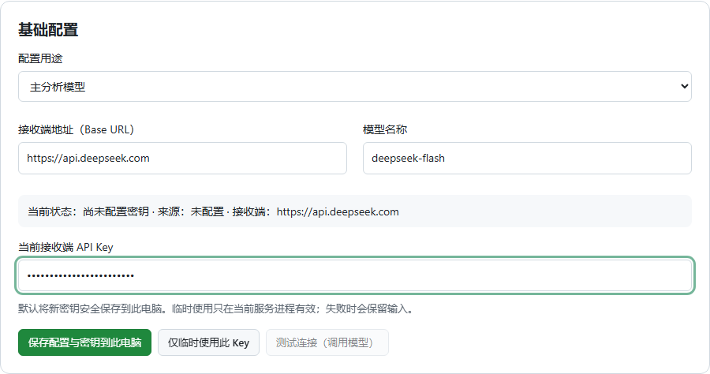
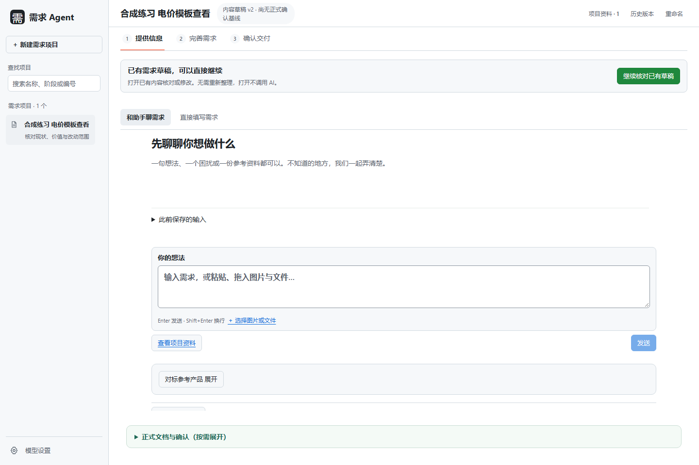
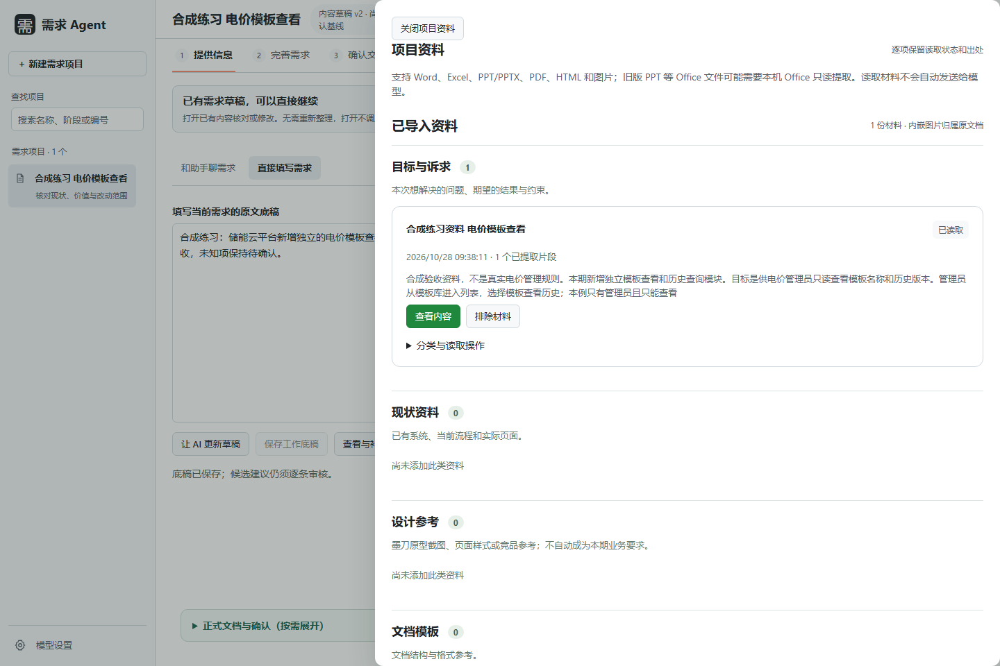
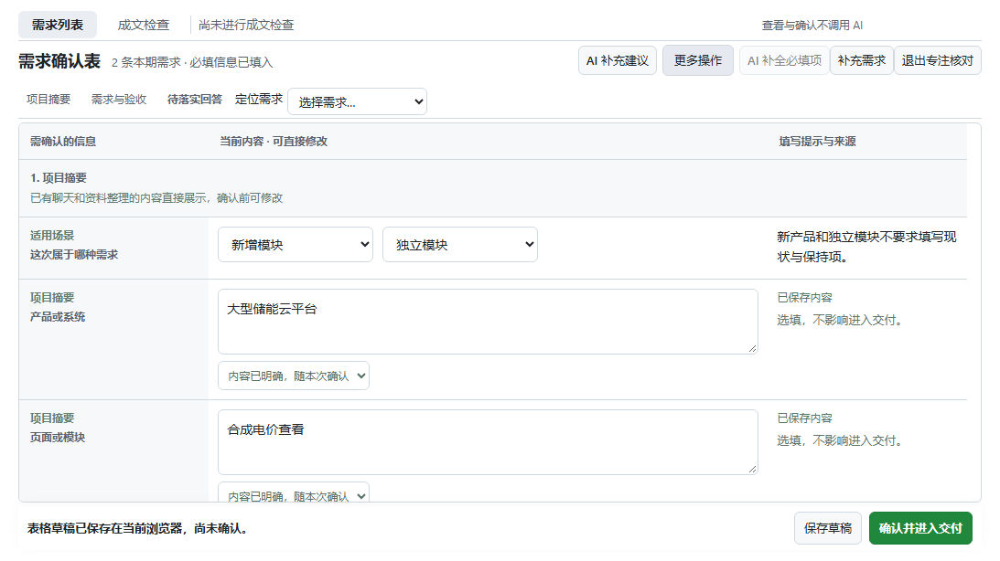
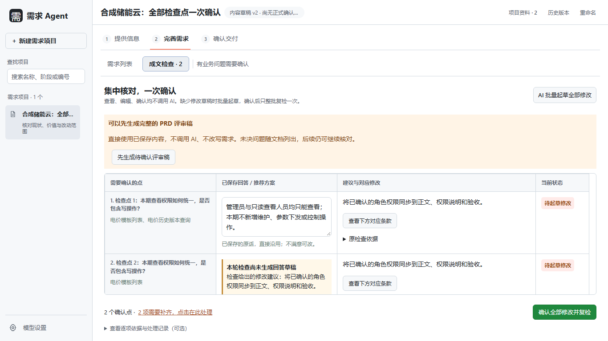
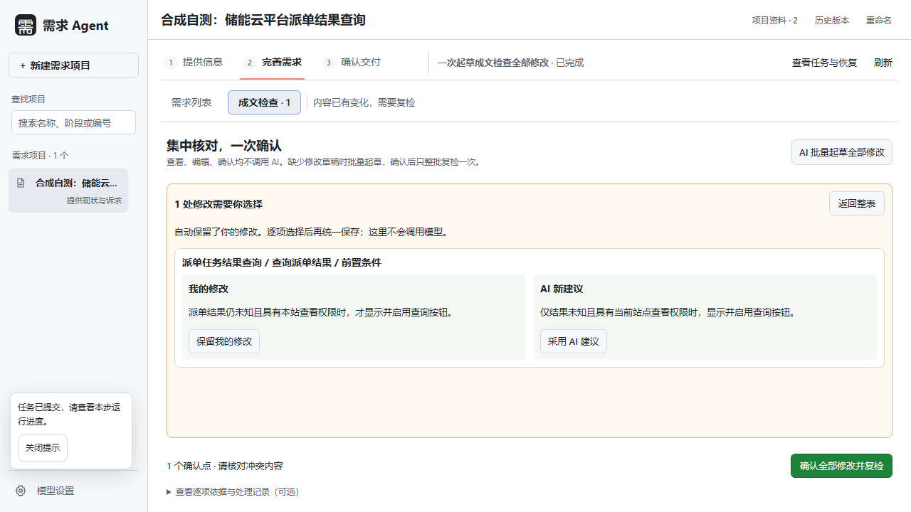
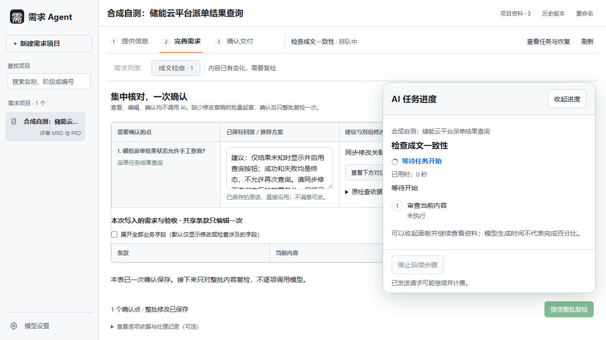
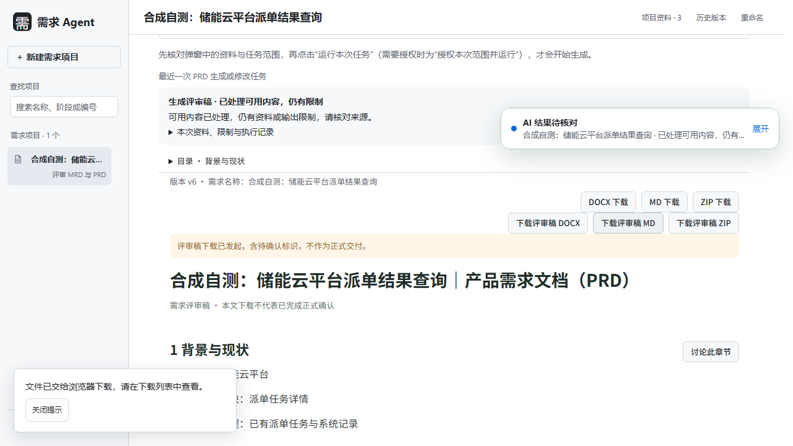

# 需求 Agent 1.2.8 图文使用说明

适用于 Windows 10/11 x64，2026-10-28 试用版。请先解压，再运行 `RequirementsAgent-1.2.8-windows-x64-setup.exe`。无需另装 Python、Node.js 或设备许可证。程序未做商业代码签名；企业策略阻止时请联系发包人或 IT。

## 1. 配置自己的模型

左下角“模型设置”填写服务商 Base URL、模型名称和自己的 API Key。以现有默认配置为例，接收端为 `https://api.deepseek.com`，模型名为 `deepseek-flash`；请以服务商账户实际可用模型为准。保存密钥到此电脑后，再按需测试连接。测试连接与模型任务可能产生费用。

纯文字可先只配置主模型；要识别图片，另配置支持图片输入的视觉模型。不要把主模型连接成功当作图片已读懂。Key 不随安装包或项目导出，换电脑需要重新配置。

## 2. 新建项目，和助手聊需求

点击“新建需求项目”，先围绕一个小需求说明使用者、问题、预期、本期范围和不做什么。打开已有项目先回到需求助手，不会自动整理或调用模型；已有草稿可点“继续核对已有草稿”。

## 3. 添加资料，核对读取结果

支持 Word、Excel、PDF、PPT/PPTX、HTML/HTM、截图和文字。“已添加”不代表内容已读取；检查读取状态并查看实际内容。PDF 不自动 OCR 或解密；旧 PPT 的后备读取需要获准使用的本机 PowerPoint。HTML 只读静态正文，不运行脚本。Office 不随包提供，企业策略与权限仍须遵守。资料读取不等于授权外发。

## 4. AI 起草，人工核对

按“整理并进入完善需求”准备任务，核对接收端、费用说明和资料范围后运行。AI 给出草稿，人工核对或修改；查看、编辑、保存草稿和确认不调用模型。笔记本可用“专注核对”增加表格空间。

## 5. 有冲突时，在同一张表集中处理

“成文检查”集中列出全部待确认点和推荐草稿。缺修改时点“AI 批量起草全部修改”，一次处理全部点；已有回答和人工编辑保留。检查涉及的旧验收会直接显示，避免只新增一条正确验收而漏掉旧冲突。

人工与 AI 改到同一处时，并排比较“我的修改 / AI 新建议”，选择保留人工内容或采用 AI 建议，再统一保存；比较与选择不调用模型。

## 6. 一次确认，整批复检

点“确认全部修改并复检”。缺项会在原表直接标红并显示输入框，不需要重新找页面；缺少真实名单等事实时不能由程序编造。补齐后仍用同一个确认按钮。确认后再运行一次整批复检，不逐条调用模型；发现新问题时在同一张表继续处理，已有回答保留。

## 7. 失败、部分输出或取消后继续

失败不会覆盖已有需求或 PRD。成文检查失败时，可在原页面点“重试本次检查”，不用重新起草已有修改；只有缺修改草稿时才点“AI 批量起草全部修改”。错误原因可以展开查看；重试仍核对任务范围，可能再次计费。模型格式或来源编号可恢复时，系统会在本次任务内追加一次修复，业务原文与有效引用保留；无法恢复时保留原稿。只生成部分可用修改时，核对未完成点并整批补齐；取消任务计划不调用模型、不清空原输入。

## 8. 生成、核对与下载 PRD

复检通过后点“返回并继续生成 PRD”。暂时不能决定业务口径时，可点“先生成待确认评审稿”，直接在本机按已保存内容成文，不调用 AI，未决事项随文档保留。失败、过期、来源或硬性结构错误仍须先处理。

“正式交付前需处理”不妨碍可用评审稿阅读与下载。评审稿有待确认标识，不能当作已完成业务批准；处理完未决事项并核对当前版本后再正式交付。旧文档和历史记录保留。

Word 导出采用炭黑暖灰配色，正文等线、标题微软雅黑，长段落按条款分开；样式栏只保留正文、标题和条款等常用样式；重新下载即可使用最新版式，无需重新调用模型。

## 9. 保存、升级与退出

先保存输入，等待任务结束，再点安装版左下角“退出工作台”确认退出。只关浏览器不会停止后台服务。固定入口为 `http://127.0.0.1:8765/`，重复启动复用同一实例。升级前正常退出并按资料权限备份 `%LOCALAPPDATA%\RequirementsAgent`；卸载保留业务数据。

## 10. 反馈问题

直接回复发包人，附软件版本、发生时间、操作步骤、预期和实际结果、完整提示、任务编号（如有）及脱敏截图。界面问题另附屏幕分辨率、Windows 显示缩放和浏览器缩放。请勿发送 API Key、完整数据目录或敏感业务材料。

截图均使用合成示例。安装及离线流程验收与真实模型质量、客户企业资料兼容性分开记录。

已保存的业务回答会在明确引用它的后续修正项中带入，不需要重新输入；这里只核对回答落实到正文和验收的修改。回答尚未落实和回答尚未保存是不同状态。
